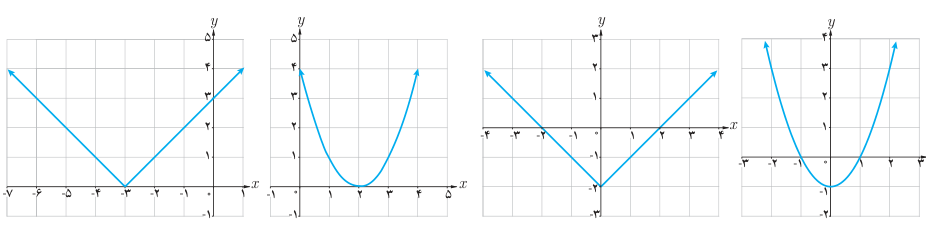
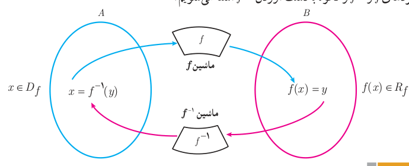
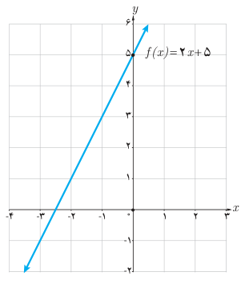

# صفحهٔ ۵۷ ـ فصل دوم: تابع

## کار در کلاس

تابع‌های زیر یک به یک نیستند. چرا؟ با محدود کردن دامنه هر یک از توابع، تابعی یک به یک بسازید.

الف) $y=|x+3|$ ؛ ب) $y=(x-2)^2$ ؛ پ) $y=|x|-2$ ؛ ت) $y=x^2-1$

## محاسبه وارون یک تابع

اگر $f$ تابعی یک به یک باشد و $f^{-1}$ تابع وارون آن باشد، نمودار زیر کارکرد $f$ و $f^{-1}$ را نشان می‌دهد. در فعالیت بعد به‌صورت جزئی‌تر با کارکردهای $f$ و $f^{-1}$ و نحوه به‌دست آوردن $f^{-1}$ آشنا می‌شویم.

## فعالیت

تابع $\begin{cases}f:\mathbb R\to\mathbb R\\f(x)=2x+5\end{cases}$ را در نظر می‌گیریم.

الف) به کمک نمودار $f$ توضیح دهید که چرا $f$ یک به یک است.

