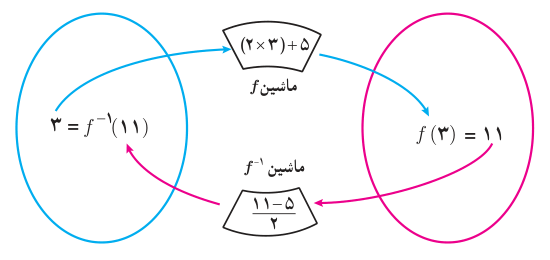
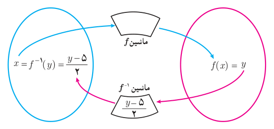

# صفحهٔ ۵۸

ب) نمودار روبه‌رو را توضیح دهید:

$$(3,11)\in f\quad و\quad(11,3)\in f^{-1}$$
به عبارت دیگر $f(3)=11$ و $f^{-1}(11)=3$.

پ) در حالت کلی برای هر عنصر $x\in D_f$، نمودار مقابل را مانند ب کامل کنید.

ت) بنابراین می‌توان نوشت:

$$f(x)=2x+5\qquad(x\in D_f)$$
$$f^{-1}(y)=\frac{y-5}{2}\qquad(y\in R_f)$$

$f^{-1}$ را به‌صورت‌های دیگری هم می‌توانیم نمایش دهیم. یک نمایش دیگر را بنویسید:

$$\begin{cases}f^{-1}:\mathbb R\to\mathbb R\\f^{-1}(y)=\frac{y-5}{2}\end{cases}\qquad\begin{cases}f^{-1}:\mathbb R\to\mathbb R\\f^{-1}(t)=\frac{t-5}{2}\end{cases}\qquad\begin{cases}f^{-1}:\mathbb R\to\mathbb R\\\ldots\end{cases}$$

آنچه که اهمیت دارد این است که دامنه $f^{-1}$ همان برد $f$ است. بنابراین یک نمایش مناسب برای $f^{-1}$ به‌صورت زیر است:

$$\begin{cases}f^{-1}:\mathbb R\to\mathbb R\\f^{-1}(x)=\frac{x-5}{2}\end{cases}$$

برای به‌دست آوردن ضابطه تابع وارون یک تابع یک‌به‌یک مانند $f$، در معادله $y=f(x)$ در صورت امکان $x$ را برحسب $y$ محاسبه می‌کنیم، سپس با تبدیل $y$ به $x$، $f^{-1}(x)$ را به‌دست می‌آوریم.
