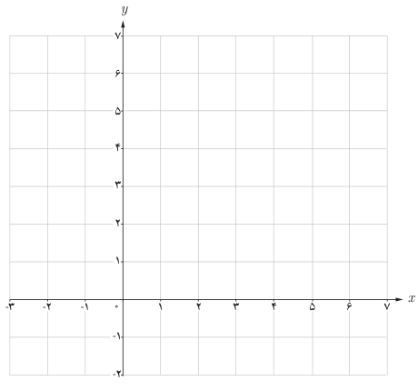
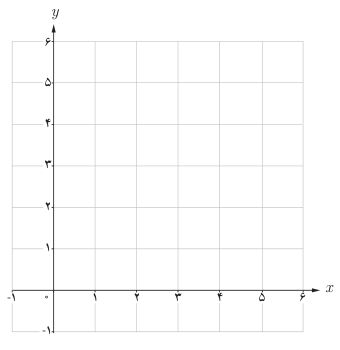

# صفحهٔ ۵۹ ـ فصل دوم: تابع

عملیات به‌دست آوردن $f^{-1}$ را به کمک نمودارهای صفحه قبل توضیح دهید.

$$\begin{aligned}f(x)=2x+5&\Rightarrow y=2x+5\\&\Rightarrow 2x=y-5\\&\Rightarrow x=\frac{y-5}{2}\\&\Rightarrow f^{-1}(y)=\frac{y-5}{2}\\&\Rightarrow f^{-1}(x)=\frac{x-5}{2}\end{aligned}$$

## کار در کلاس

۱. با توجه به فعالیت قبل اگر داشته باشیم $f(x)=2x+5$، نمودار $f$ و $f^{-1}$ را در یک دستگاه مختصات رسم کنید.

۲. اگر داشته باشیم $f(x)=\sqrt{x-2}$، دامنه و برد $f$ را به‌دست آورید و نمودار آن را رسم کنید. در معادله $y=\sqrt{x-2}$ ضابطه $f^{-1}$ را بنویسید. نمودار $f^{-1}$ را رسم و دامنه و برد $f^{-1}$ را معلوم کنید.

اگر $f$ یک تابع یک به یک باشد، برای به‌دست آوردن نمودار تابع $f^{-1}$ کافی است قرینه نمودار تابع $f$ را نسبت به خط $y=x$ (نیمساز ربع اول و سوم) به‌دست آوریم.
