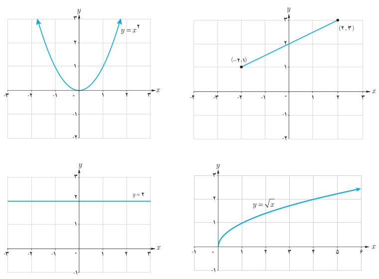
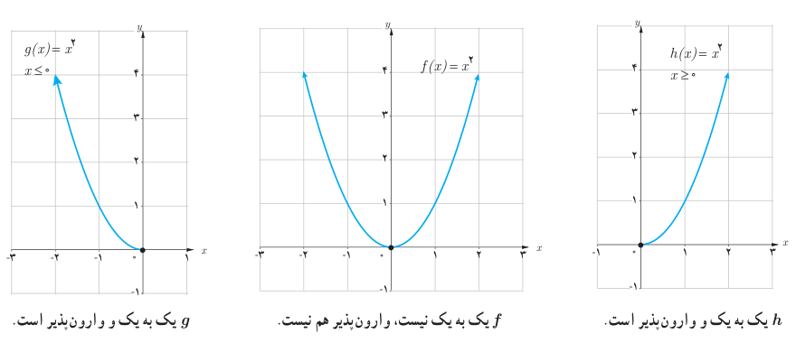

# صفحهٔ ۶۰

## کار در کلاس

نمودار «تابع وارون» هر کدام از تابع‌های زیر را که یک به یک است در همان دستگاه مختصات رسم کنید.

اگر تابعی یک به یک نباشد وارون‌پذیر هم نیست. اما گاهی با محدود کردن دامنه یک تابع، می‌توان تابعی یک به یک به‌دست آورد. به‌طور مثال تابع $f(x)=x^2$ یک به یک نیست، ولی با محدود کردن تابع به بازهٔ $[0,\infty)$ و یا $(-\infty,0]$ تابعی یک به یک به‌دست می‌آید.

$g$ یک به یک و وارون‌پذیر است. $f$ یک به یک نیست، وارون‌پذیر هم نیست. $h$ یک به یک و وارون‌پذیر است.
