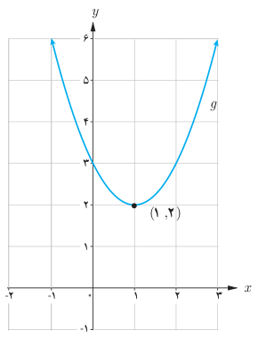
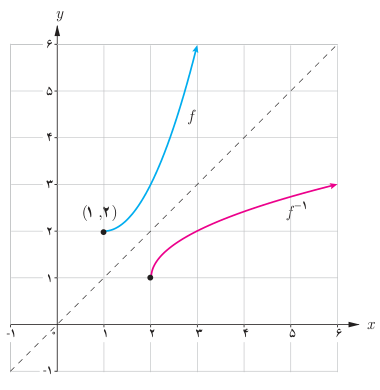

# صفحهٔ ۶۱ ـ فصل دوم: تابع

**مثال:** نمودار تابع $g(x)=x^2-2x+3$ نشان می‌دهد که این تابع یک‌به‌یک نیست. به‌طور مثال $g(0)=g(2)$. می‌توان دامنه این تابع را محدود کرد و تابعی یک به یک به‌دست آورد و سپس وارون آن را حساب کرد.

در مورد تابع $g$ داریم:

$$g:\mathbb R\to\mathbb R\qquad D_g=\mathbb R\quad و\quad R_g=[2,+\infty)$$
$$g(x)=x^2-2x+3=(x-1)^2+2$$

دامنه $f$ را به بازهٔ $[1,+\infty)$ محدود می‌کنیم و تابع جدید را $f$ می‌نامیم. بنابراین تابع جدید به‌صورت زیر خواهد بود که تابع یک به یک و وارون‌پذیر است.

$$\begin{cases}f:[1,+\infty)\to\mathbb R\\f(x)=(x-1)^2+2\end{cases}\qquad D_f=[1,+\infty),\quad R_f=[2,+\infty)$$

اکنون سعی می‌کنیم $x$ را برحسب $y$ به‌دست آوریم:

$$y=(x-1)^2+2\Rightarrow y-2=(x-1)^2\Rightarrow(x-1)^2=y-2\Rightarrow x-1=\pm\sqrt{y-2}$$

جواب منفی قابل قبول نیست (چرا؟) بنابراین:

$$x-1=\sqrt{y-2}\Rightarrow x=\sqrt{y-2}+1\Rightarrow f^{-1}(x)=\sqrt{x-2}+1$$

در حقیقت داریم:

$$\begin{cases}f^{-1}:[2,\infty)\to\mathbb R\\f^{-1}(x)=\sqrt{x-2}+1\end{cases}\qquad D_{f^{-1}}=[2,+\infty)\qquad R_{f^{-1}}=[1,+\infty)$$

نمودار $f$ و $f^{-1}$ در یک دستگاه مختصات رسم شده‌اند.

