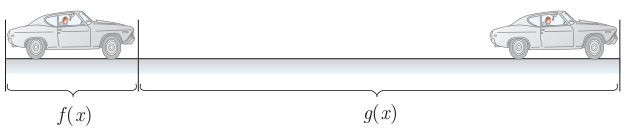

# درس ۴: اعمال روی توابع

همان‌گونه که عمل‌های جمع و ضرب در مورد دو عدد یا دو چندجمله‌ای انجام‌پذیر است، برای دو تابع نیز چنین اعمالی قابل انجام است. در فعالیت زیر مثالی واقعی از این موضوع بررسی می‌شود.

## فعالیت

فرض کنید خودرویی با سرعت ثابت در بزرگراهی در حال حرکت است. اگر خودرو با سرعت $x$ کیلومتر بر ساعت حرکت کند، مسافتی که در «زمان عکس‌العمل» طی می‌کند از تابع $f(x)=\frac7{10}x$ به‌دست می‌آید که در آن مقدار تابع برحسب متر است.

همچنین مسافتی که خودرو پس از فشار دادن پدال ترمز تا توقف کامل طی می‌کند از تابع $g(x)=\frac1{100}x^2$ به‌دست می‌آید که در آن مقدار تابع برحسب متر است و $x$ سرعت خودرو برحسب کیلومتر بر ساعت است.

الف) اگر خودرویی با سرعت ۱۰۰ کیلومتر بر ساعت حرکت کند، پس از دیدن مانع، تا توقف کامل چه مسافتی طی می‌شود؟

ب) اگر سرعت خودرو $x$ کیلومتر بر ساعت باشد، تابعی بنویسید که مسافت طی شده توسط خودرو پس از رؤیت مانع توسط راننده و ترمز کردن را نمایش دهد. این تابع را با $h(x)$ نمایش دهید.

پ) اگر این خودرو پس از پیمودن ۶۰ متر متوقف شود، با چه سرعتی در حال حرکت بوده است؟

فاصله زمانی لحظه‌ای که راننده با یک مانع روبه‌رو می‌شود تا لحظه فشار دادن پدال ترمز را «زمان عکس‌العمل» می‌نامند.

مجموع فاصله طی شده در طول زمان عکس‌العمل و فاصله طی شده پس از ترمز کردن را «فاصله دید توقف» می‌نامند. این فاصله در طراحی جاده‌ها و بزرگراه‌ها کاربرد دارد.

۱. برای تعیین فاصله دید توقف، فاصله عکس‌العمل ترمز مبتنی بر زمان ۲.۵ ثانیه و شتاب کاهنده ۳.۴ متر بر مجذور ثانیه مورد استفاده قرار می‌گیرد.
