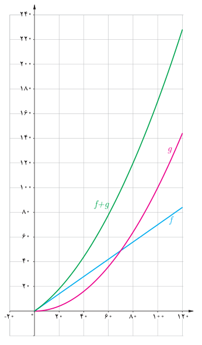

# صفحهٔ ۶۴

اگر $f$ و $g$ دو تابع باشند، $f+g$ تابعی است که دامنه آن مجموعهٔ $D_f\cap D_g$ است و به‌صورت زیر تعریف می‌شود:

$$(f+g)(x)=f(x)+g(x)\qquad x\in D_f\cap D_g$$

در فعالیت قبل دامنه $f$ و دامنه $g$ در حالت کلی مجموعهٔ $\mathbb R$ است، ولی در این مسئله واقعی دامنه تابع مجموعه‌ای مانند $[0,120]$ است. بنابراین دامنه $f+g$ نیز چنین است. نمودارهای سه تابع $f$، $g$ و $f+g$، فعالیت قبل، در شکل روبه‌رو رسم شده است. رابطه بین این توابع را به کمک نمودار آنها توضیح دهید.

## کار در کلاس

۱. اگر $f(x)=x+2$ و $g(x)=\sqrt{x-1}$، $f+g$ را محاسبه کنید. دامنه تابع $f+g$ را به‌دست آورید.

۲. اگر $f=\{(1,2),(-2,5),(0,7)\}$ و $g=\{(1,5),(2,4),(0,-1)\}$ ابتدا دامنه $f+g$ را به‌دست آورید و سپس $f+g$ را به‌صورت مجموعه‌ای از زوج‌های مرتب نمایش دهید.

به‌طور کلی اگر $f$ و $g$ دو تابع باشند توابع $f+g$، $f-g$، $f\cdot g$ و $\frac fg$ به‌صورت زیر تعریف می‌شوند:

$$(f+g)(x)=f(x)+g(x)\qquad D_{f+g}=D_f\cap D_g$$
$$(f-g)(x)=f(x)-g(x)\qquad D_{f-g}=D_f\cap D_g$$
$$(f\cdot g)(x)=f(x)\cdot g(x)\qquad D_{f\cdot g}=D_f\cap D_g$$
$$\left(\frac fg\right)(x)=\frac{f(x)}{g(x)}\qquad D_{f/g}=D_f\cap D_g-\{x\mid g(x)=0\}$$
