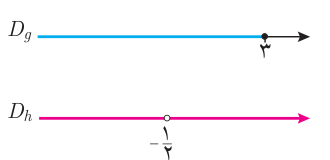
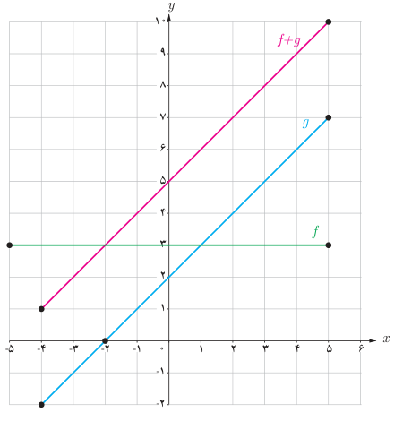

# صفحهٔ ۶۵ ـ فصل دوم: تابع

**مثال:** اگر $f(x)=\sqrt{x+2}$ و $g(x)=\sqrt{3-x}$ و $h(x)=\frac{x+2}{2x+1}$ توابع $f+g$، $g-h$، $gh$ و $\frac fg$ را محاسبه کنید و دامنه آنها را به‌دست آورید. کدام‌یک از مقادیر $(f+g)(2)$ و $(f+g)(5)$ وجود دارند؟

**حل:** ابتدا دامنه هر یک از توابع را به‌دست می‌آوریم:

$$D_f=[-2,\infty)\qquad D_g=(-\infty,3]\qquad D_h=\mathbb R-\{-\tfrac12\}$$

$(f+g)(2)=3$ ولی $(f+g)(5)$ وجود ندارد.

$$(f+g)(x)=f(x)+g(x)=\sqrt{x+2}+\sqrt{3-x}\qquad D_{f+g}=D_f\cap D_g=[-2,3]$$
$$(g\cdot h)(x)=g(x)h(x)=\sqrt{3-x}\left(\frac{x+2}{2x+1}\right)\qquad D_{g\cdot h}=D_g\cap D_h=(-\infty,3]-\{-\tfrac12\}$$
$$(g-h)(x)=g(x)-h(x)=\sqrt{3-x}-\frac{x+2}{2x+1}\qquad D_{g-h}=(-\infty,-\tfrac12)\cup(-\tfrac12,3]$$
$$\left(\frac fg\right)(x)=\frac{f(x)}{g(x)}=\frac{\sqrt{x+2}}{\sqrt{3-x}}\qquad D_{f/g}=D_f\cap D_g-\{x\mid g(x)=0\}=[-2,3]-\{3\}$$

## فعالیت

در شکل روبه‌رو نمودارهای دو تابع $f$ و $g$ داده شده‌اند.

الف) دامنه $f$ و دامنه $g$ و ضابطه‌های $f$ و $g$ را بنویسید.

ب) دامنه و ضابطه توابع $f+g$، $f-g$، $f\cdot g$ و $\frac fg$ را به‌دست آورید.

پ) نمودار $f+g$ در شکل رسم شده است. توضیح دهید چگونه این نمودار را رسم کرده‌ایم.

ت) توضیح دهید بقیه نمودارهای توابع داده شده در قسمت (ب) را چگونه می‌توان رسم کرد.

