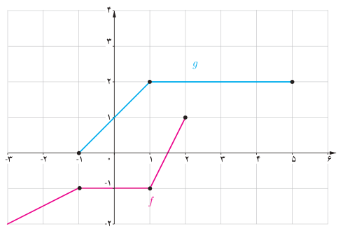
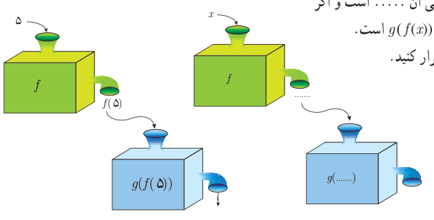

# صفحهٔ ۶۶

## کار در کلاس

نمودارهای توابع $f$ و $g$ داده شده است.

الف) مقادیر $(f+g)(1)$ و $(f+g)(-1)$ را به‌دست آورید.

ب) با استفاده از نمودارهای $f$ و $g$ نمودار تابع $f+g$ را در همین شکل رسم کنید.

پ) ضابطه توابع $f+g$ و $f$ و $g$ را به‌دست آورید.

ت) نمودار $f+g$ را به کمک ضابطه آن رسم کنید و با (ب) مقایسه کنید.

## ترکیب توابع

با داشتن دو تابع $f$ و $g$ به شیوه‌ای دیگر هم می‌توان تابع جدیدی ساخت. در فعالیت زیر با این موضوع آشنا می‌شویم.

## فعالیت

تابع $f(x)=\frac59(x-32)$ درجه فارنهایت را به درجه سانتی‌گراد تبدیل می‌کند.

الف) $f(32)=0$ به چه معنی است؟ ۵۰ درجه فارنهایت چند درجه سانتی‌گراد است؟

ب) تابع $g(x)=x+273$ درجه سانتی‌گراد را به درجه کلوین تبدیل می‌کند. $g(0)=273$ به چه معنی است؟

پ) مطابق نمودارهای داده شده می‌توانیم $f$ و $g$ را همانند دو ماشین در نظر بگیریم. یکی از ماشین‌ها فارنهایت را به سانتی‌گراد و دیگری سانتی‌گراد را به کلوین تبدیل می‌کند. به کمک نمودارها نشان دهید که ۵ درجه فارنهایت معادل چند درجه کلوین است؟

$$f(5)=\ldots\qquad g(f(5))=g(\ldots)$$

ت) اگر $x$ ورودی تابع $f$ باشد، خروجی آن ..... است و اگر ورودی تابع $g$، ...... باشد خروجی آن $g(f(x))$ است.

ث) ت را با تکمیل نمودارهای زیر تکرار کنید.

