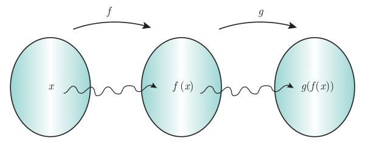
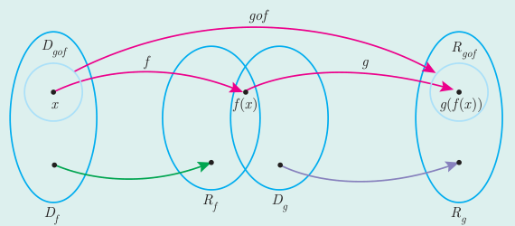

# صفحهٔ ۶۷ ـ فصل دوم: تابع

نمودارهای صفحه قبل را به‌صورت زیر هم می‌توان نمایش داد:

اما $g(f(x))$ را چگونه می‌توان محاسبه کرد؟ داریم:

$$g(f(x))=g\left(\frac59(x-32)\right)$$

و می‌دانیم تابع $g$ به هر ورودی ۲۷۳ واحد اضافه می‌کند. پس:

$$g(f(x))=\frac59(x-32)+273$$

این یک تابع جدید است که درجه فارنهایت را به کلوین تبدیل می‌کند و به دلیل شیوه محاسبه آن با $g\circ f$ (بخوانید جی او اف) نمایش داده می‌شود. در حقیقت $g\circ f$ نیز همانند ماشینی عمل می‌کند که ورودی $x$ را به $g(f(x))$ تبدیل می‌کند.

اگر $f$ و $g$ دو تابع باشند ترکیب $g$ با $f$ را با $g\circ f$ نمایش می‌دهیم و آن را به‌صورت زیر تعریف می‌کنیم؛ به شرط آنکه مقادیر $f$ در دامنه $g$ قرار داشته باشند:

$$(g\circ f)(x)=g(f(x))$$

$$D_{g\circ f}=\{x\in D_f\mid f(x)\in D_g\}$$

به‌طور مشابه ترکیب $f$ با $g$ یعنی $f\circ g$ را می‌توان تعریف کرد.
