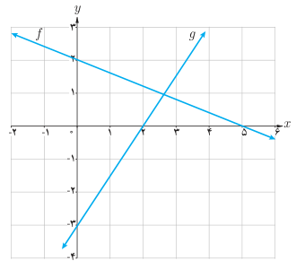

# صفحهٔ ۶۹ ـ فصل دوم: تابع

## تمرین

۱. اگر $f(x)=4x$ و $g(x)=2-x$، توابع $\frac fg$، $f-g$ و $f\circ g$ را به همراه دامنه آنها به‌دست آورید.

۲. برای دو تابع $f(x)=\frac1{x-3}$ و $g(x)=\frac4x$ تابع $f\circ g$ و دامنه آن را به‌دست آورید.

۳. کدام‌یک از گزاره‌های زیر درست و کدام یک نادرست است؟

الف) اگر $g(4)=7$ و $f(7)=5$ آن‌گاه $(f\circ g)(4)=35$

ب) اگر $f(x)=x+4$ و $g(x)=3x$ آن‌گاه $(\frac fg)(2)=1$

پ) اگر $g(x)=2x-1$ و $f(x)=\sqrt{x}$ آن‌گاه $(f\circ g)(5)=g(2)$

ت) برای هر دو تابع $f$ و $g$ داریم: $f\circ g=g\circ f$

ث) اگر $f(x)=x^2-4$ و $g(x)=\sqrt{x^2-4}$، آن‌گاه $(f\circ g)(5)=-25$ و $(f\circ g)(x)=-x^2$

ج) برای هر دو تابع $f$ و $g$ داریم: $fg=gf$

۴. فرض کنیم $\begin{cases}g:\mathbb N\to\mathbb N\\g(n)=2n\end{cases}$ و $f:A\to\mathbb N$ به این صورت تعریف شود: $f=\{(1,2),(2,3),(3,5),(4,7)\}$ که در آن $A=\{1,2,3,4\}$، توابع $f+g$ و $g\circ f$ را به‌دست آورید.

۵. اگر $f=\{(-4,13),(-1,7),(0,5),(\frac52,0),(3,-5)\}$ و $g=\{(-4,-7),(-2,-5),(0,-3),(3,0),(5,2),(9,6)\}$ توابع $f+g$ و $f-g$ و $\frac fg$ را به‌دست آورید.

۶. اگر $f(x)=\sqrt{x^2+5}$ و $g(x)=\sqrt{4-x^2}$، دامنه و ضابطه توابع $f\circ g$ و $g\circ f$ را به‌دست آورید.

۷. اگر $f(x)=x^2-9$ و $g(x)=x+3$، ضابطه $\frac fg$ و دامنه آن در ادامه محاسبه شده‌اند. چه اشتباهی در محاسبه رخ داده است؟

$$\frac{f(x)}{g(x)}=\frac{x^2-9}{x+3}=\frac{(x-3)(x+3)}{x+3}=x-3\quad,\quad D_{f/g}=\mathbb R$$

۸. اگر $f(x)=2x+5$، $f^{-1}(x)$، $f\circ f^{-1}$ و $f^{-1}\circ f$ را به‌دست آورید.

۹. نمودار توابع $f$ و $g$ داده شده‌اند. ضابطه $f+g$، $f-g$ و $fg$ را محاسبه کنید.

