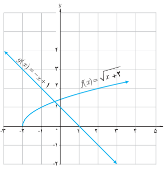

# صفحهٔ ۷۰

۱۰. با توجه به نمودار مقابل، هرکدام از عبارت‌های داده شده را در صورت امکان محاسبه کنید.

الف) $(f+g)(2)$ ؛ ب) $(f+g)(-3)$ ؛ پ) $(fg)(\frac12)$ ؛ ت) $(f\circ g)(-4)$ ؛ ث) $(\frac fg)(0)$ ؛ ج) $(g\circ f)(-1)$

۱۱. نشان دهید که وارون (معکوس) هر تابع خطی به‌صورت $y=ax+b$ ($a\ne0$) باز هم یک تابع خطی است.

۱۲. تابع $f(x)=\frac59(x-32)$ درجه فارنهایت را به درجه سانتی‌گراد تبدیل می‌کند. تابعی بنویسید که درجه سانتی‌گراد را به عنوان ورودی دریافت کند و درجه فارنهایت را به عنوان خروجی تحویل دهد.

۱۳. در تصاویر زیر طرح جلد چند کتاب پرفروش در حوزه خاطرات دفاع مقدس را می‌بینید:

یکی از این کتاب‌ها در چاپ اول ۱۰ هزار نسخه و در هر یک از چاپ‌های دیگر ۷ هزار نسخه تولید شده است. کتاب دیگر در چاپ اول ۲۰ هزار نسخه و در هر یک از چاپ‌های بعدی ۹ هزار نسخه به چاپ رسیده است.

الف) تابع‌هایی بنویسید که تعداد نسخه‌های چاپ شده هر یک از این دو کتاب را برحسب شماره چاپ نمایش دهند.

ب) تابعی بنویسید که مجموع نسخه‌های چاپ شده هر دو کتاب را نمایش دهد.

پ) نمودار هر سه تابع را در یک دستگاه محورهای مختصات رسم کنید.

