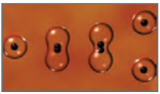

# درس ۱: تابع نمایی

آیا تاکنون با خود فکر کرده‌اید که دانشمندان چگونه قدمت یک شیء باستانی یا یک فسیل را پیدا می‌کنند؟ در بدن هر موجود زنده کربن ۱۴ موجود است که با مرگ آن موجود، کربن ۱۴ شروع به از بین رفتن می‌کند. بنابراین با اندازه‌گیری مقدار کربن باقی‌مانده، می‌توان سن آن شیء یا موجود را پیدا کرد. در حل این‌گونه مسائل از تابع نمایی استفاده می‌شود.

## فعالیت

یک توده باکتری را در محیط کشت در نظر بگیرید. فرض کنید با نمونه‌گیری از این جامعه، مشخص شده است که جرم باکتری‌ها در هر ساعت دو برابر می‌شود. اگر جرم باکتری‌ها را پس از $t$ ساعت با $m(t)$ نشان دهیم و با ۱ گرم شروع کنیم یعنی $m(0)=1$، آن‌گاه با توجه به جدول، به پرسش‌های زیر پاسخ دهید.

جدول (۱)

| زمان $t$ (ساعت) | جرم باکتری‌ها $m(t)$ |
|---|---|
| ۰ | ۱ |
| ۱ | ۲ |
| ۲ | ۴ |
| ۳ | ۸ |
| ؟ | ۱۶ |
| ۵ | ؟ |
| ۶ | ؟ |
| ⋮ | ⋮ |
| ؟ | ۱۰۲۴ |

الف) در زمان‌های $t=6$ و $t=5$ جرم باکتری‌ها را به‌دست آورید.

ب) پس از چند ساعت جرم باکتری‌ها ۲۵۶ گرم می‌شود؟ پس از چند ساعت به ۱۰۲۴ گرم می‌رسد؟

پ) آیا از اعداد این جدول می‌توان الگویی را برای محاسبه جرم باکتری‌ها در هر زمان به‌دست آورد؟

تقسیم دوتایی نوعی تولید مثل است که به تولید زاده‌هایی یکسان منجر می‌شود.
