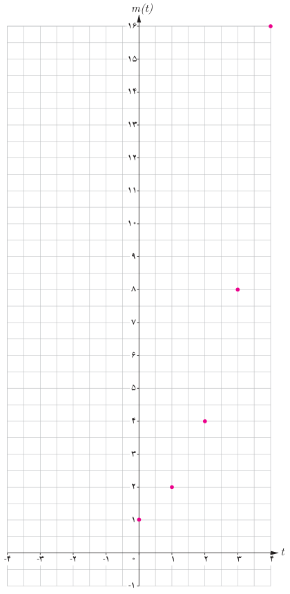

# صفحهٔ ۷۳ ـ فصل سوم: توابع نمایی و لگاریتم

اگر بخواهیم جرم باکتری‌ها را در مرحله یازدهم یا مرحله‌ای بالاتر پیدا کنیم، قطعاً محاسبات، خیلی دشوارتر و وقت‌گیر خواهد شد. برای ساده‌تر شدن محاسبات، جدول (۱) را بر اساس توان‌های ۲، بازنویسی می‌کنیم تا جدول (۲) حاصل شود. در جدول (۲) به جای علامت سؤال‌ها اعداد مناسب قرار دهید.

جدول (۲)

| $t$ | $m(t)$ |
|---|---|
| ۰ | $2^0=1$ |
| ۱ | $2^1=2$ |
| ۲ | $2^2=4$ |
| ۳ | ؟ |
| ⋮ | ⋮ |
| ؟ | $2^9=\text{؟}$ |

نمودار روبه‌رو رابطه بین زمان و جرم باکتری‌ها را نشان می‌دهد. با توجه به فعالیت صفحه قبل، جرم باکتری‌ها در پایان ساعت اول، دوم، ... و $n$ام از دنباله زیر به‌دست می‌آید:

$$2^1,2^2,2^3,\ldots,2^n$$

به عبارت دیگر، جرم باکتری‌ها برحسب زمان $t$، از رابطه $m(t)=2^t$ به‌دست می‌آید.

## فعالیت

در نمودار فعالیت قبل، طول نقاط مشخص شده اعداد صحیح نامنفی هستند. می‌توان نقاطی از آن نمودار، با طول اعداد گویا را نیز به‌دست آورد.

الف) جاهای خالی جدول را با قرار دادن اعداد مناسب پر کنید.

| $x$ | $-3$ | $-2$ | $-1$ | $0$ | $\frac13$ | $\frac12$ | $\frac23$ | $1$ | $\frac32$ | $2$ | $3$ |
|---|---|---|---|---|---|---|---|---|---|---|---|
| $2^x$ | $2^{-3}$ | ... | ... | $2^0$ | $2^{1/3}$ | ... | $2^{2/3}$ | ... | $2^{3/2}$ | ... | ... |
| $f(x)$ | $\frac18$ | ... | ... | ... | $\sqrt[3]2\simeq1.26$ | $\sqrt2\simeq1.4$ | $\sqrt[3]4\simeq1.56$ | ... | $\sqrt8\simeq2.83$ | ... | ... |
