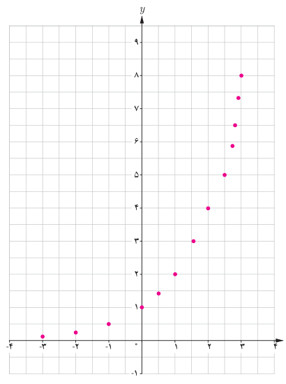
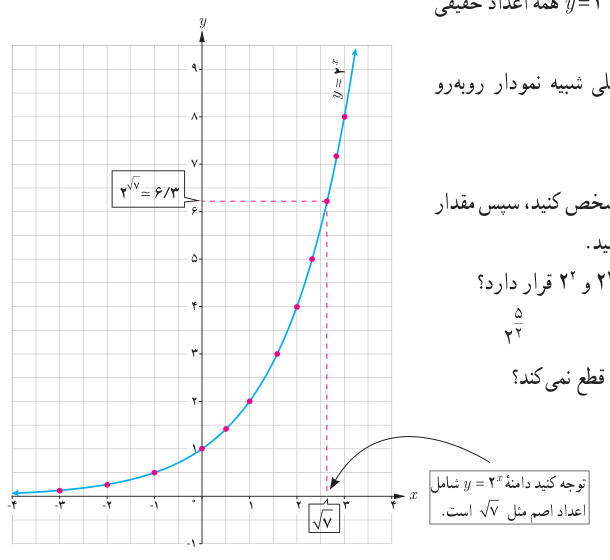
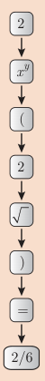

# صفحهٔ ۷۴

ب) نقاط به‌دست آمده را در یک صفحه شطرنجی مشخص کنید (برخی از نقاط در دستگاه مشخص شده‌اند).

همان‌طور که ملاحظه می‌شود دامنه تابع $y=2^x$ همه اعداد حقیقی و برد آن همواره اعداد مثبت است. اگر تعداد نقاط خیلی زیاد شوند، شکلی شبیه نمودار روبه‌رو حاصل می‌شود.

پ) چرا نمودار روبه‌رو یک تابع است؟

ت) نقطه $x=\sqrt2$ را روی محور $x$ها مشخص کنید، سپس مقدار تقریبی $2^{\sqrt2}$ را با استفاده از نمودار پیدا کنید.

ث) کدام‌یک از اعداد زیر، بین دو عدد $2^2$ و $2^3$ قرار دارد؟

$$2^{-1}\qquad 2^5\qquad 2^{3/2}\qquad 2^{5/2}$$

ج) چرا نمودار تابع $y=2^x$ محور $x$ها را قطع نمی‌کند؟

توجه کنید دامنه $y=2^x$ شامل اعداد اصم مثل $\sqrt7$ است.

## خواندنی

به دلیل افزایش حجم محاسبات در زندگی روزمره، بیش از گذشته به ماشین حساب نیازمندیم. برای محاسبه $2^{\sqrt2}$ مراحل روبه‌رو را انجام می‌دهیم:

اکنون مقادیر $2^{0.5}$، $3^{\sqrt5}$، $3^{1+\sqrt2}$ و $3^{1-\sqrt5}$ را تا دو رقم اعشار با استفاده از ماشین حساب به‌دست آورید.
