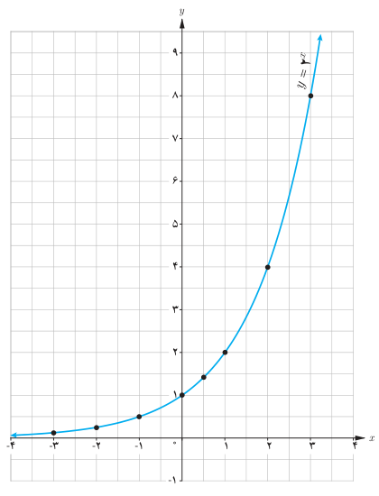
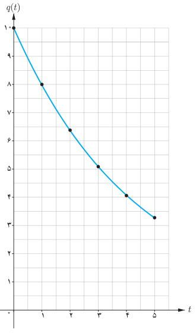

# صفحهٔ ۷۵ ـ فصل سوم: توابع نمایی و لگاریتم

## کار در کلاس

الف) نمودار تابع $y=(\frac12)^x$ را رسم کنید و آن را با نمودار $y=2^x$ مقایسه کنید.

ب) دامنه و برد تابع را به‌دست آورید.

پ) نقطه $(0.5,(\frac12)^{0.5})$ را روی نمودار مشخص کنید.

هر تابع با ضابطه $f(x)=a^x$، که در آن $a$ عددی مثبت و مخالف یک است را یک تابع نمایی می‌نامیم.

**مثال:** توابع زیر همگی نمایی هستند:

$$g(x)=(\tfrac12)^x,\qquad h(x)=(\tfrac32)^x,\qquad f(x)=(3.14)^x$$

**تذکر:** در حالت کلی هر تابع با ضابطه $h(x)=ka^x$ ($k\ne0$، $a>0$، $a\ne1$) رفتار نمایی دارد. به‌عنوان مثال، توابع $f(x)=3\times2^x$ یا $g(x)=(\frac25)^{x-1}$ رفتار نمایی دارند.

**مثال:** اگر ۱۰ گرم نمک را به مقدار کمی آب اضافه کنیم، مقدار نمک حل نشده در آب پس از $t$ دقیقه از رابطه $q(t)=10(\frac45)^t$ به‌دست می‌آید. بنابراین پس از مثلاً ۴ دقیقه، مقدار نمک حل نشده در آب برابر است با:

$$q(4)=10(\tfrac45)^4=4.096\,gr$$

نمودار این تابع برای $0\leq t\leq5$ در شکل روبه‌رو رسم شده است.

