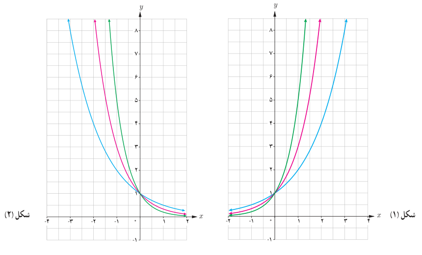

# صفحهٔ ۷۶

**مثال:** فرض کنید $Q$ جرم یک مقدار کربن ۱۴ برحسب گرم با نیمه عمر ۵۷۳۰ سال باشد (یعنی پس از ۵۷۳۰ سال نصف مقدار معینی از آن از بین می‌رود). مقدار این کربن بعد از $t$ سال از رابطه $Q(t)=10(\frac12)^{t/5730}$ به‌دست می‌آید.

الف) در لحظه $t=0$ داریم $Q(0)=10\,gr$ و بعد از ۲۰۰۰ سال داریم:

$$Q(2000)=10(\tfrac12)^{2000/5730}\simeq7.85\,gr$$

ب) اگر $t=5730$، آن‌گاه $Q(5730)=10\times\frac12=5\,gr$ یعنی بعد از ۵۷۳۰ سال، مقدار کربن ۱۴ نصف می‌شود.

## کار در کلاس

۱. نمودارهای سه تابع $f(x)=2^x$، $g(x)=3^x$ و $h(x)=5^x$ در شکل (۱) رسم شده‌اند. ضابطه هر تابع را روی نمودار آن بنویسید.

۲. دامنه و برد هر تابع را بنویسید.

۳. آیا این توابع یک‌به‌یک هستند؟ چرا؟

۴. نمودارهای توابع $u(x)=(\frac12)^x$، $v(x)=(\frac13)^x$ و $t(x)=(\frac15)^x$ در شکل (۲) رسم شده‌اند. ابتدا ضابطه هر یک را روی نمودار آن بنویسید و سپس دامنه و برد آنها را به‌دست آورید. آیا این توابع یک‌به‌یک هستند؟

