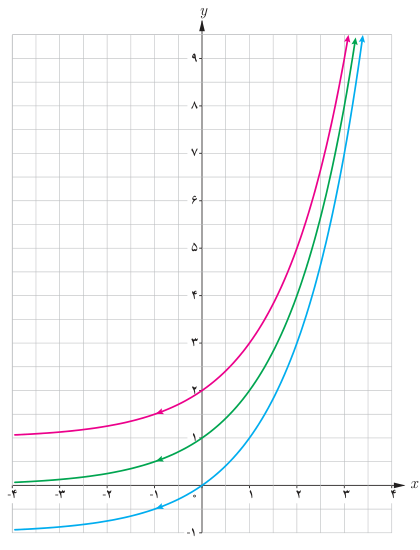
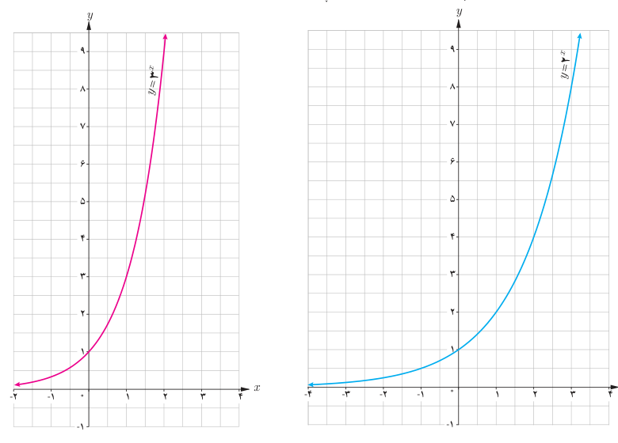

# صفحهٔ ۷۸

۲. نمودار توابع $y=2^x$، $y=2^x+1$ و $y=2^x-1$ در شکل روبه‌رو آمده‌اند. ضابطه هر تابع را روی آن مشخص کنید. با مقایسه نمودارهای توابع $y=a^x$، $y=a^x+2$ و $y=a^x-2$ با یکدیگر چه نتیجه‌ای می‌گیرید؟ ($a>1$)

۳. داروها در بدن با ادرار دفع می‌شوند. فرض کنید ۱۰ میلی‌گرم از یک نوع دارو در بدن شخصی قرار دارد و مقدار آن پس از $t$ ساعت از رابطه $A(t)=10(0.8)^t$ به‌دست می‌آید.

الف) مقدار دارو پس از ۸ ساعت چقدر است؟

ب) چه درصدی از دارو در هر ساعت از بین می‌رود؟

۴. الف) سه عدد بین اعداد $3^{2.5}$ و $3^{\sqrt{10}}$ پیدا کنید.

ب) نامعادله توانی $4^{2x-1}>\frac1{1024}$ را حل کنید.

پ) اگر $x$، $y$ و $z$ سه عدد حقیقی باشند، به‌طوری که $a^x>a^y>a^z$، آن‌گاه چه رابطه‌ای بین $x$ و $y$ و $z$ برقرار است؟ ($a>1$)

۵. ابتدا مقدار تقریبی هر عدد را به کمک نمودار پیدا کنید. سپس به کمک ماشین حساب، درستی پاسخ خود را بررسی کنید.

الف) $3^{1-\sqrt2}$ ؛ ب) $2^{1.25}$ ؛ پ) $3^{3/2}$

