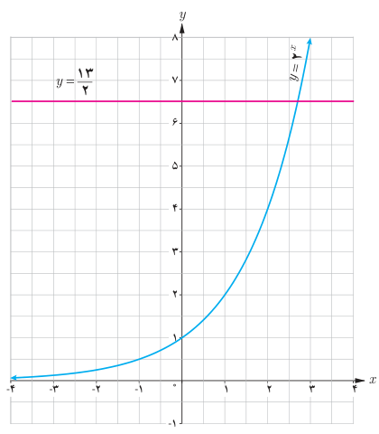
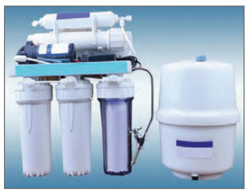

# صفحهٔ ۷۹ ـ فصل سوم: توابع نمایی و لگاریتم

۶. الف) در شکل زیر خط $y=\frac{13}{2}$ نمودار $y=2^x$ را قطع کرده است. طول نقطه برخورد بین کدام دو عدد صحیح قرار دارد؟ چرا؟

ب) خط $y=\sqrt7$ را رسم کنید. طول نقطه برخورد این خط و نمودار $y=2^x$ بین کدام دو عدد صحیح قرار دارد؟

۷. در تصفیه آب، داخل فیلترها، لایه تمیزکننده‌ای قرار دارد که حدود ۳۰ درصد از ناخالصی‌ها را حذف می‌کند و در نتیجه ۷۰ درصد از ناخالصی‌ها باقی می‌ماند. اگر داخل این فیلترها، دو لایه قرار دهیم، آنگاه $0.7\times0.7=0.49$ یا ۴۹ درصد از ناخالصی‌ها باقی می‌ماند.

الف) درصد ناخالصی‌های موجود در آب از کدام رابطه به‌دست می‌آید؟

ب) با قرار دادن چند لایه در فیلتر می‌توان بیش از ۹۶ درصد از ناخالصی‌های آب را از بین برد؟

