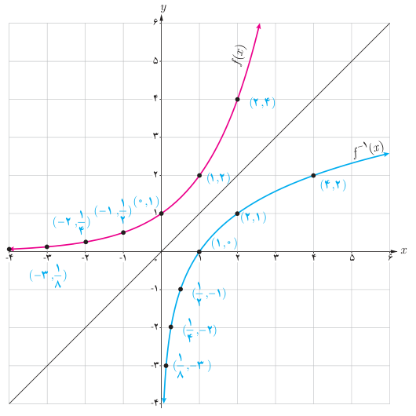

# درس ۲: تابع لگاریتمی و لگاریتم

بار دیگر، مسئله افزایش جرم توده باکتری در محیط کشت را که در ابتدای این فصل مطرح شد، در نظر بگیرید. می‌خواهیم بدانیم در چه زمانی وزن باکتری‌ها ۵۱۲ گرم است، یعنی اگر $m(t)=512$، می‌خواهیم $t$ را بیابیم. چون تابع $m(t)=2^t$ یک تابع یک به یک است، پس وارون‌پذیر است و از این رو $t=m^{-1}(512)$. به جدول‌های زیر نگاه کنید:

| $t$ (زمان) | $m(t)=p$، جرم باکتری‌ها در زمان $t$ |
|---|---|
| ۰ | ۱ |
| ۱ | ۲ |
| ۲ | ۴ |
| ۳ | ۸ |
| ۴ | ۱۶ |
| ۵ | ۳۲ |

| $t$ (زمان) | $m^{-1}(p)$، زمان رسیدن به جرم $p$ |
|---|---|
| ۰ | ۱ |
| ۱ | ۲ |
| ۲ | ۴ |
| ۳ | ۸ |
| ۴ | ۱۶ |
| ۵ | ۳۲ |

نمودارهای تابع $y=f(x)=2^x$ و تابع وارون آن در شکل روبه‌رو رسم شده‌اند. دقت کنید که برای رسم تابع وارون $y=2^x$ کافی است قرینه نقاط روی تابع را نسبت به خط $y=x$ پیدا کنیم. به عنوان مثال، نقطه $(2,4)$ روی تابع نمایی $y=2^x$ و نقطه $(4,2)$ که قرینه آن نسبت به خط $y=x$ است، روی تابع وارون آن (تابع لگاریتمی) قرار دارد. می‌توان دید:

$$D_f=(-\infty,+\infty),\quad R_f=(0,+\infty)$$
$$D_{f^{-1}}=(0,+\infty),\quad R_{f^{-1}}=(-\infty,+\infty)$$

توجه کنید که دامنه $f$ با برد $f^{-1}$ برابر است و برد $f$ با دامنه $f^{-1}$.

## خواندنی: جان نپیر (John Napier)

جان نپیر ریاضیدان اسکاتلندی مفهوم لگاریتم را پایه‌ریزی کرد. لگاریتم برای ساده کردن محاسبات ابداع شد و در قرن ۱۶ و ۱۷ بزرگ‌ترین پیشرفت در علم حساب بود. لگاریتم در علوم زیادی کاربرد دارد. مثلاً در زلزله‌شناسی برای اندازه‌گیری شدت زلزله برحسب ریشتر کاربرد دارد. لگاریتم در حسابداری و مسائل مالی نیز کاربردهای زیادی دارد.
