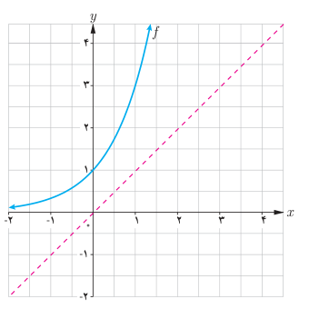
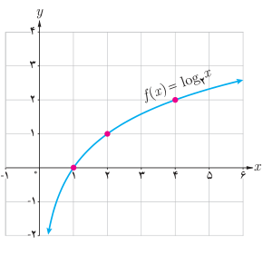

# صفحهٔ ۸۱ ـ فصل سوم: توابع نمایی و لگاریتم

## فعالیت

۱. با توجه به نمودار تابع $f(x)=3^x$ نمودار تابع $f^{-1}$ را رسم کنید و جدول زیر را کامل کنید.

| تابع | وارون |
|---|---|
| $f(-2)=3^{-2}=\frac19$ | $f^{-1}(\frac19)=-2$ |
| $f(-1)=$ |  |
| $f(0)=$ |  |
| $f(1)=$ |  |
| $f(\frac32)=$ |  |
| $f(2)=$ |  |

۲. گزینه درست را با ✓ و گزینه غلط را با × علامت بزنید.

- نقطه $(-2,\frac19)$ روی نمودار $f$ قرار دارد.
- نقطه $(\frac13,-1)$ روی نمودار $f^{-1}$ قرار دارد.
- نقطه $(0,1)$ روی نمودار $f$ قرار دارد.
- نقطه $(-2,\frac19)$ روی نمودار $f^{-1}$ قرار دارد.
- تابع $f^{-1}$ یک به یک است.

فرض کنید داریم $f(x)=3^x$ و $y=f^{-1}(x)$. در این صورت $y$ را لگاریتم $x$ در پایه ۳ می‌خوانیم و آن را با نماد $y=\log_3x$ نشان می‌دهیم و می‌خوانیم لگاریتم $x$ در پایه ۳.

اگر $a$ عددی مثبت و مخالف یک باشد، تابع نمایی $f(x)=a^x$ یک به یک است و از این رو دارای تابع وارون $f^{-1}$ است که تابع لگاریتمی پایه $a$ نامیده می‌شود و با نماد $y=\log_a x$ نشان داده می‌شود.

**مثال:** وارون تابع $f(x)=5^x$ تابع $f^{-1}(x)=\log_5x$ است. همچنین وارون تابع $g(x)=(\frac13)^x$ تابع $g^{-1}(x)=\log_{1/3}x$ است.

**مثال:** با توجه به نمودار $f(x)=\log_2x$، می‌توان دید:

$$f(1)=0\qquad f(2)=1\qquad f(4)=2$$

