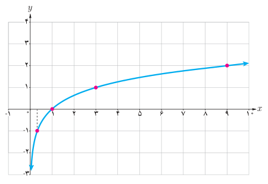
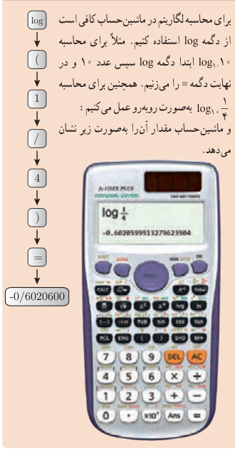

# صفحهٔ ۸۲

**مثال:** مقادیر زیر با استفاده از نمودار $f(x)=\log_3x$ به‌دست آمده‌اند.

$$f(1)=0,\quad f(3)=1,\quad f(\tfrac13)=-1,\quad f(9)=2$$

به‌طور کلی:

$$y=\log_a x\iff a^y=x$$

به عنوان مثال، $\log_2 8=3$ زیرا $2^3=8$ و یا $\log_{10}1000=3$، زیرا $10^3=1000$. همچنین $\log_{10}\frac1{100}=-2$، زیرا $10^{-2}=\frac1{10^2}=\frac1{100}$.

**مثال:** فرض کنید $f(x)=\log_{10}x$. مقدار تابع $f$ را در هر یک از نقاط زیر در صورت وجود، حساب کنید.

الف) $x=10$ ؛ ب) $x=100$ ؛ پ) $x=-2$ ؛ ت) $x=1000$

**حل:**

الف) $f(10)=\log_{10}10=1$، زیرا $10^1=10$.

ب) $f(100)=\log_{10}100=2$، زیرا $10^2=100$.

پ) $f(-10)$ موجود نیست، زیرا لگاریتم اعداد منفی تعریف نمی‌شود.

ت) $f(1000)=\log_{10}1000=3$، زیرا $10^3=1000$.

## خواندنی

برای محاسبه لگاریتم در ماشین حساب کافی است از دگمه log استفاده کنیم. مثلاً برای محاسبه $\log_{10}10$ ابتدا دگمه log سپس عدد ۱۰ و در نهایت دگمه = را می‌زنیم. همچنین برای محاسبه $\log_{10}\frac14$ به‌صورت روبه‌رو عمل می‌کنیم و ماشین حساب مقدار آن را به‌صورت زیر نشان می‌دهد.

