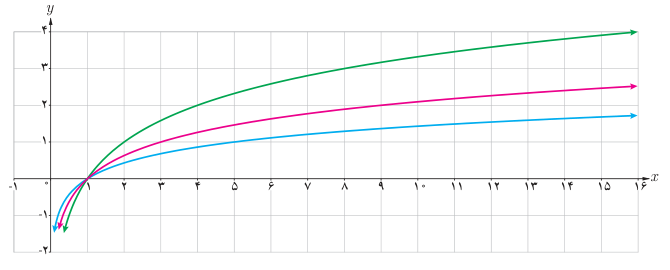

# صفحهٔ ۸۳ ـ فصل سوم: توابع نمایی و لگاریتم

**مثال:** با توجه به تعریف لگاریتم، جدول زیر را داریم:

| $2^5=32$ | $6^2=36$ | $5^3=125$ | $2^{10}=1024$ | $3^4=81$ |
|---|---|---|---|---|
| $\log_2 32=5$ | $\log_6 36=2$ | $\log_5 125=3$ | $\log_2 1024=10$ | $\log_3 81=4$ |

**مثال:** تساوی‌های زیر را به صورت توانی بیان کنید.

الف) $\log_7 1=0$ ؛ ب) $\log_3\frac1{27}=-3$

**حل:** الف) اگر $\log_7 1=0$، آن‌گاه طبق تعریف داریم $7^0=1$.

ب) اگر $\log_3\frac1{27}=-3$، آن‌گاه طبق تعریف داریم $3^{-3}=\frac1{27}$.

**مثال:** مقادیر زیر را محاسبه کنید:

الف) $\log_2 32$ ؛ ب) $\log_6 6$ ؛ پ) $\log_4 1$

**حل:** الف) اگر $a=\log_2 32$، آن‌گاه طبق تعریف داریم $2^a=32$ و از این رو $a=5$.

ب) اگر $b=\log_6 6$، آن‌گاه $6^b=6$ و در نتیجه $b=1$.

پ) اگر $c=\log_4 1$، آن‌گاه $4^c=1$ و در نتیجه $c=0$.

## کار در کلاس

۱. الف) نمودار سه تابع $f(x)=\log_2x$، $g(x)=\log_3x$ و $h(x)=\log_5x$ در شکل زیر رسم شده‌اند. ضابطه هر یک را روی نمودار آن بنویسید.

ب) محل دقیق هر یک از نقاط زیر را روی نمودار متناظرش نشان دهید.

$$(16,4)\quad و\quad(9,2)\quad و\quad(5,1)$$

