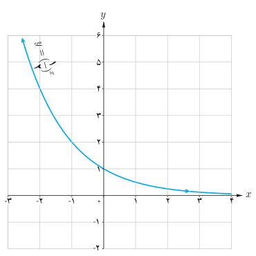
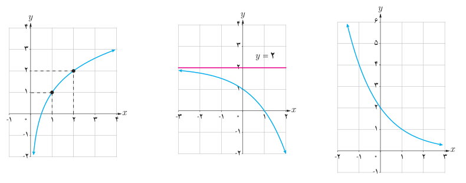

# صفحهٔ ۸۴

پ) با توجه به نمودار $y=(\frac12)^x$ نمودار $y=\log_{1/2}x$ را رسم کنید و سپس آنها را با هم مقایسه کنید.

۲. مشخص کنید هر یک از نمودارهای زیر به کدام‌یک از ضابطه‌های زیر تعلق دارد؟

الف) $y=-2^x+2$ ؛ ب) $y=\log_2x+1$ ؛ پ) $y=(\frac12)^{x-1}$

۳. حاصل عبارت‌های زیر را به‌دست آورید.

الف) $\log_3 81$ ؛ ب) $\log_{1/6}\frac16$ ؛ پ) $\log_2 8$
