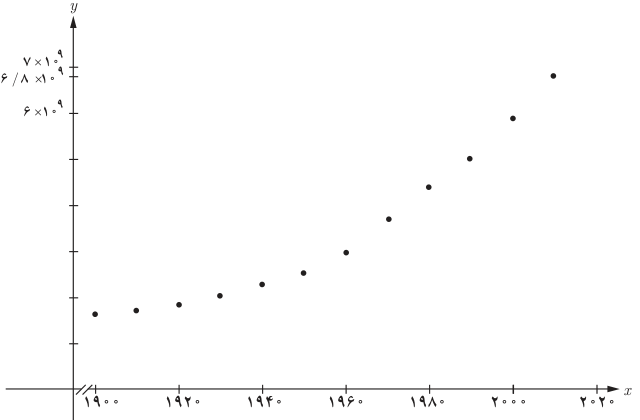

# صفحهٔ ۸۸

## فعالیت

معادله‌های لگاریتمی زیر را حل کنید:

الف) $\log_5(2x-1)=\log_5x$ ؛ ب) $\log_3(x-1)+\log_3(\frac x2+1)=2$ ؛ پ) $\log x+\log(x+3)=1$

## کاربردهای لگاریتم

**مثال:** جدول زیر، جمعیت جهان را در قرن بیستم و پایان دهه اول قرن بیست‌ویکم نشان می‌دهد.

| سال | ۱۹۰۰ | ۱۹۱۰ | ۱۹۲۰ | ۱۹۳۰ | ۱۹۴۰ | ۱۹۵۰ | ۱۹۶۰ | ۱۹۷۰ | ۱۹۸۰ | ۱۹۹۰ | ۲۰۰۰ | ۲۰۱۰ |
|---|---|---|---|---|---|---|---|---|---|---|---|---|
| جمعیت (میلیون) | ۱۶۵۰ | ۱۷۵۰ | ۱۸۶۰ | ۲۰۷۰ | ۲۳۰۰ | ۲۵۶۰ | ۳۰۴۰ | ۳۷۱۰ | ۴۴۵۰ | ۵۲۸۰ | ۶۰۸۰ | ۶۸۰۰ |

الف) با توجه به جدول، نمودار جمعیت جهان برحسب سال به صورت زیر است:

ب) اگر محور $x$ها بیانگر سال و محور $y$ها بیانگر جمعیت باشد، تابع جمعیت در انتهای هر سال به‌صورت $g(x)=0.008(1.01376)^x$ برآورد می‌شود. به سادگی دیده می‌شود که جمعیت در پایان سال ۲۰۱۶ تقریباً برابر است با:

$$g(2016)=0.008(1.01376)^{2016}\simeq7,385,074,512$$

در اینجا می‌توان حدس زد که در چه سالی جمعیت جهان به ۸ میلیارد خواهد رسید، زیرا داریم:

$$g(x)=8\times10^{-3}(1.01376)^x=8\times10^9$$
$$\Rightarrow(1.01376)^x=10^{12}\Rightarrow x\log1.01376=\log10^{12}\Rightarrow x=\frac{12}{\log1.01376}\simeq2021$$
$$(\log1.01376\simeq0.005935)$$

۱. دقت کنید که نقطه ابتدایی دامنه تابع $g(x)$ نقطه ۱۹۰۰ است.
