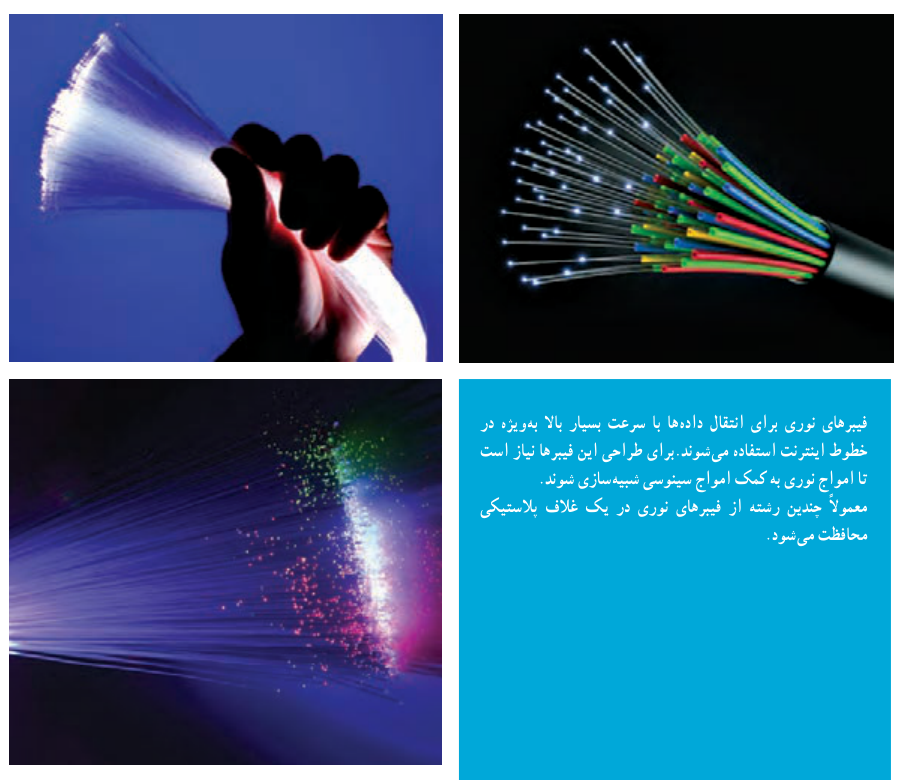

# فصل ۴: مثلثات

۱. رادیان

۲. نسبت‌های مثلثاتی برخی زوایا

۳. توابع مثلثاتی

۴. روابط مثلثاتی مجموع و تفاضل زوایا

فیبرهای نوری برای انتقال داده‌ها با سرعت بسیار بالا به‌ویژه در خطوط اینترنت استفاده می‌شوند. برای طراحی این فیبرها نیاز است تا امواج نوری به کمک امواج سینوسی شبیه‌سازی شوند. معمولاً چندین رشته از فیبرهای نوری در یک غلاف پلاستیکی محافظت می‌شود.

