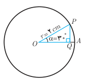
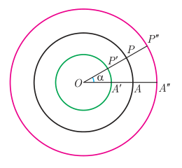

# درس ۱: رادیان

تاکنون زاویه‌ها را برحسب «درجه» اندازه‌گیری می‌کردیم. استفاده از واحد «درجه» برای اندازه‌گیری زوایا در هندسه بسیار متداول است. اما در برخی محاسبات فنی بهتر است از واحدهای دیگری استفاده شود. در ادامه با یک واحد دیگر اندازه‌گیری زوایا، به نام رادیان، آشنا می‌شویم.

## فعالیت

۱. دایره مقابل به مرکز $O$ و به شعاع ۲ سانتی‌متر داده شده است. اندازه ضلع $PQ$ در مثلث $OPQ$ را با استفاده از نسبت‌های مثلثاتی سال گذشته به‌دست آورید.

۲. با توجه به اینکه کمان $30^\circ$ برابر $\frac1{12}$ کل محیط دایره است (چرا؟) می‌توان طول کمان روبه‌رو به زاویه $\alpha$ (یعنی $\widehat{PA}$) را به‌صورت زیر به‌دست آورد.

$$\widehat{PA}=\frac1{12}\times(\text{محیط دایره})=\frac1{12}\times2\pi\times2=\frac4{12}\pi=\frac\pi3\,cm$$

اکنون به مرکز $O$ دایره‌های دیگری به شعاع‌های ۱ و ۳ سانتی‌متر رسم می‌کنیم (شکل روبه‌رو).

الف) مطابق فرمول بالا طول کمان‌های $\widehat{P'A'}$ و $\widehat{P''A''}$ را که روبه‌رو به زاویه $\alpha=30^\circ$ هستند به‌دست آورید.

$$\widehat{P'A'}=\ldots\qquad\widehat{P''A''}=\ldots$$

ب) در هر دایره نسبت طول کمان روبه‌رو به زاویه $\alpha$ به شعاع آن دایره را محاسبه کنید. این نسبت‌ها با هم چه رابطه‌ای دارند؟

$$\frac{\widehat{PA}}{OP}=\ldots\qquad\frac{\widehat{P'A'}}{OP'}=\ldots\qquad\frac{\widehat{P''A''}}{OP''}=\ldots$$
