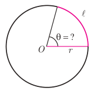
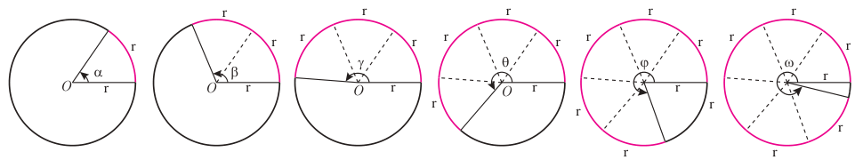
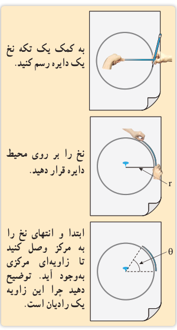

# صفحهٔ ۹۳ ـ فصل چهارم: مثلثات

پ) اگر در شکل صفحه قبل دایره‌ای به شعاع $r$ و به مرکز $O$ در نظر بگیریم، آیا نسبت فوق در آن دایره تغییری می‌کند؟ چرا؟ با تکمیل رابطه زیر، به این سؤال پاسخ دهید.

$$\frac{\frac1{12}\times2\pi\times r}{r}=\ldots$$

در سؤال قبل دیدیم که نسبت طول کمان روبه‌رو به زاویه $30^\circ$ به شعاع، در همه دایره‌ها برابر مقدار ثابت ...... است. اکنون در سؤال زیر به این می‌پردازیم که این نسبت چه زمانی برابر ۱ است.

۳. در یک دایره به شعاع $r$، مانند شکل زیر، طول کمان روبه‌رو به زاویه $\theta$ (کمان $\ell$) برابر طول شعاع دایره است. نسبت طول کمان به شعاع چقدر است؟ اندازه زاویه $\theta$ تقریباً چند درجه است؟ (از نقاله استفاده کنید)

همان‌طور که در فعالیت قبل مشاهده کردید نسبت طول کمان روبه‌رو به یک زاویه به شعاع دایره همواره مقداری ثابت است. از این مقدار ثابت برای بیان اندازه زاویه می‌توان استفاده کرد؛ مثلاً در سؤال ۳ فعالیت قبل، این نسبت برای زاویه $\theta$ برابر یک است. در این صورت می‌گویند اندازه زاویه $\theta$ برابر ۱ رادیان است.

**یک رادیان**، در هر دایره دلخواه، اندازه زاویه‌ای مرکزی است که طول کمان روبه‌رو به آن برابر طول شعاع دایره است. معمولاً از نماد $rad$ برای نمایش اندازه یک زاویه بر حسب رادیان استفاده می‌شود.

در زیر زاویه‌های ۱ تا ۶ رادیان در دایره‌ای به شعاع دلخواه $r$ رسم شده‌اند. در هر شکل به نسبت طول کمان روبه‌رو به هر زاویه به شعاع دقت کنید.

$$\alpha=\frac rr=1\,rad\quad\beta=\frac{2r}r=2\,rad\quad\gamma=\frac{3r}r=3\,rad\quad\theta=\frac{4r}r=4\,rad\quad\varphi=\frac{5r}r=5\,rad\quad\omega=\frac{6r}r=6\,rad$$

به کمک یک تکه نخ یک دایره رسم کنید. نخ را بر روی محیط دایره قرار دهید. ابتدا و انتهای نخ را به مرکز وصل کنید تا زاویه‌ای مرکزی به‌وجود آید. توضیح دهید چرا این زاویه یک رادیان است.

