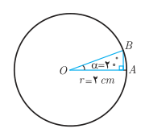
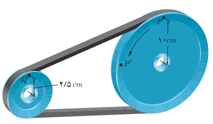

# صفحهٔ ۹۴

**مثال:** اندازه یک زاویه نیم‌صفحه ($180^\circ$) و نیز یک زاویه قائمه ($90^\circ$) برحسب رادیان چقدر است؟

**حل:** می‌دانیم که طول کمان روبه‌رو به زاویه نیم‌صفحه، نصف محیط دایره است. بنابراین داریم:

$$\frac{2\pi r/2}{r}=\frac{\pi r}{r}=\pi\,rad$$

پس یک زاویه $180^\circ$ برابر $\pi$ رادیان می‌باشد. به‌طور مشابه طول کمان روبه‌رو به یک زاویه قائمه، ربع محیط دایره است. پس:

$$\frac{2\pi r/4}{r}=\frac{\frac\pi2r}{r}=\frac\pi2\,rad$$

همواره بین اندازه یک زاویه مانند $\theta$ برحسب رادیان و طول کمان $l$ روبه‌رو به آن در یک دایره به شعاع $r$ رابطه زیر برقرار است.

$$\theta=\frac lr$$

**مثال:** در شکل مقابل اندازه زاویه $\alpha$ را برحسب رادیان به‌دست آورید، سپس طول $\widehat{AB}$ را پیدا کنید.

**حل:** از مثال قبل می‌دانیم که هر زاویه $180^\circ$ برابر $\pi$ رادیان است. بنابراین داریم:

$$\frac{20}{\alpha\ (\text{برحسب رادیان})}=\frac{180}{\pi}\Rightarrow\alpha=\frac{20\pi}{180}=\frac\pi9\,rad$$

پس زاویه $\alpha$ برابر $\frac\pi9$ رادیان است. اکنون برای به‌دست آوردن طول $\widehat{AB}$ داریم:

$$\alpha=\frac{\widehat{AB}}r\Rightarrow\frac\pi9=\frac{\widehat{AB}}2\Rightarrow\widehat{AB}=\frac{2\pi}9\,cm$$

اگر $D$ اندازه زاویه‌ای برحسب درجه و $R$ اندازه آن برحسب رادیان باشد، آنگاه:

$$\frac D{180}=\frac R\pi$$

**مثال:** در شکل مقابل، یک تسمه دو قرقره به شعاع‌های $10\,cm$ و $2.5\,cm$ را به هم وصل کرده است. بررسی کنید که وقتی قرقره بزرگ‌تر $\frac\pi2$ رادیان می‌چرخد (یعنی نقطه $P$ در موقعیت $P'$ قرار می‌گیرد) قرقره کوچک‌تر چند رادیان می‌چرخد. ($\pi\,rad\simeq3.14\,rad$)

**حل:** ابتدا مسافتی را که نقطه $P$ بر روی محیط قرقره بزرگ‌تر طی می‌کند به‌دست می‌آوریم.

$$\theta=\frac{\widehat{PP'}}r\Rightarrow\widehat{PP'}=r\theta=10\times\frac\pi2=5\pi\,cm\simeq15.7\,cm$$
