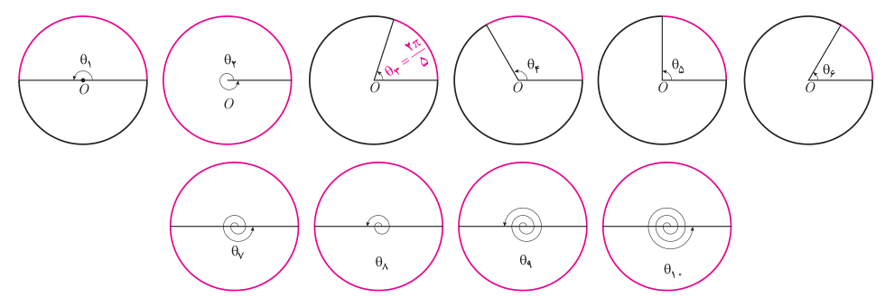

# فصل چهارم: مثلثات — ۹۵

چون هر دو قرقره با یک تسمه به هم متصل هستند پس قرقره کوچک‌تر نیز $5\pi\,cm$ حرکت می‌کند. برای این قرقره داریم:

$$\theta=\frac{l}{r}=\frac{5\pi}{2/5}=\frac{5\pi}{\frac52}=2\pi\ rad$$

بنابراین وقتی قرقره بزرگ‌تر ربع دور می‌چرخد، قرقره کوچک‌تر یک دور کامل می‌چرخد و نقطه $Q$ به مکان خود بازمی‌گردد.

## کار در کلاس

۱. در جدول روبه‌رو جاهای خالی را پر کنید.

| زاویه برحسب درجه | ۰° | ۳۰° |  |  | ۹۰° |  | ۲۷۰° |  | ۳۹۰° |  |
|---|---|---|---|---|---|---|---|---|---|---|
| زاویه برحسب رادیان | ۰ |  | $\frac\pi4$ | $\frac\pi3$ |  | $\pi$ |  | $2\pi$ |  | $\frac{7\pi}3$ |

۲. در زیر، اندازه برخی از زاویه‌ها بر حسب رادیان داده شده است. مانند نمونه، آنها را با زاویه‌های داده شده در دایره‌های مثلثاتی زیر نظیر کنید.

الف) $\frac{2\pi}{6}$؛ ب) $\frac{2\pi}{5}$؛ پ) $\frac{2\pi}{4}$؛ ت) $\frac{2\pi}{3}$؛ ث) $\frac{2\pi}{2}$؛ ج) $2\pi$؛ چ) $3\pi$؛ ح) $4\pi$؛ خ) $5\pi$؛ د) $6\pi$

۳. در جدول روبه‌رو، که سال گذشته آن را بر حسب درجه کامل کرده‌اید، مقدار نسبت‌های مثلثاتی خواسته شده را در جاهای خالی بنویسید.

| نسبت / $\theta$ (رادیان) | ۰ | $\frac\pi6$ | $\frac\pi4$ | $\frac\pi3$ | $\frac\pi2$ | $\frac{3\pi}2$ | $2\pi$ |
|---|---|---|---|---|---|---|---|
| $\sin\theta$ | ۰ |  |  |  | ۱ |  |  |
| $\cos\theta$ |  |  | $\frac{\sqrt2}2$ |  |  |  |  |
| $\tan\theta$ |  | $\frac{\sqrt3}3$ |  |  |  |  |  |
| $\cot\theta$ | تعریف نشده |  |  |  | ۰ |  |  |
