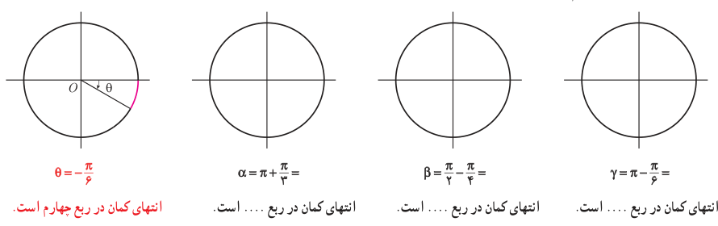
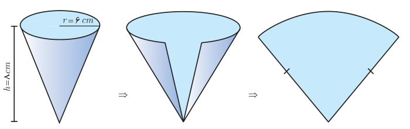

# ۹۶

## تمرین

۱. برای هر یک از زاویه‌های زیر مشخص کنید که انتهای کمان در کدام ربع دایره مثلثاتی قرار می‌گیرد و سپس شکل تقریبی زاویه را همانند نمونه رسم کنید.

$\gamma=\pi-\frac\pi6=$ ... انتهای کمان در ربع .... است.

$\beta=\frac\pi2-\frac\pi4=$ ... انتهای کمان در ربع .... است.

$\alpha=\pi+\frac\pi3=$ ... انتهای کمان در ربع .... است.

$\theta=-\frac\pi6$؛ انتهای کمان در ربع چهارم است.

۲. طول برف پاک‌کن عقب خودرویی ۲۴ سانتی‌متر است. فرض کنید برف‌پاک‌کن، کمانی به اندازه ۱۲۰° طی می‌کند. $(\pi\simeq3/14)$

الف) اندازه کمان را برحسب رادیان به‌دست آورید.

ب) طول کمان طی شده توسط نوک برف پاک‌کن چند سانتی‌متر است؟

۳. شکل فضایی و نیز شکل گسترده یک مخروط در زیر داده شده است. شعاع قاعده مخروط $r=6\,cm$ و ارتفاع آن $h=8\,cm$ می‌باشد. اندازه زاویه قطاع¹ حاصل از شکل گسترده این مخروط چند رادیان است؟

۱- به قسمتی از سطح دایره که بین دو شعاع و کمانی از دایره است قطاع گفته می‌شود.
