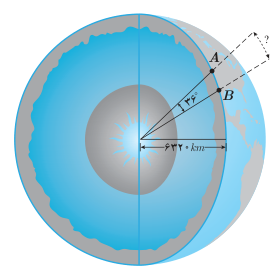
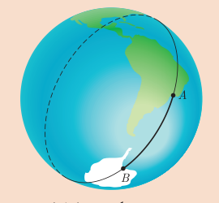
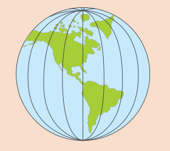
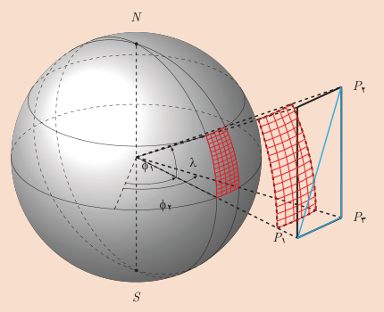

# فصل چهارم: مثلثات — ۹۷

۴. فاصله دو نقطه $A$ و $B$ از کره زمین، که بر روی یک نصف‌النهار قرار دارند، مطابق شکل روبه‌رو، برابر طول کمانی از دایره گذرنده از آن دو نقطه است. با داشتن اندازه شعاع کره زمین فاصله بین دو نقطه داده شده را بیابید.

## خواندنی

به فاصله بین دو نقطه داده شده در تمرین ۴ در اصطلاح فنی «فاصله ژئودزیک» دو نقطه گفته می‌شود. برای محاسبه فاصله ژئودزیک بین دو نقطه از کره زمین لزومی ندارد که آن دو نقطه بر روی یک نصف‌النهار باشند. در عمل با استفاده از سیستم مکان‌یابی جهانی (GPS) موقعیت جغرافیایی آن دو نقطه را برحسب طول و عرض جغرافیایی آنها به‌دست می‌آورند و سپس با استفاده از محاسبات پیچیده‌ای فاصله ژئودزیک بین آن دو نقطه را محاسبه می‌کنند. در تمام این محاسبات که در آن از مثلثات کروی استفاده می‌شود باید زوایا برحسب رادیان در نظر گرفته شوند، در غیر این‌صورت محاسبات به مراتب پیچیده‌تر می‌گردد. فاصله ژئودزیک بین دو نقطه از کره زمین کوتاه‌ترین فاصله‌ای است که بین آن دو نقطه می‌توان پیدا کرد. این فاصله، طول کمانی از بزرگ‌ترین دایره‌ای است که از آن دو نقطه می‌گذرد و به آن «دایره عظیمه» می‌گویند. محاسبه فاصله ژئودزیک بین دو نقطه از کره زمین در طراحی مسیرهای هوایی و دریایی و نیز هدایت ماهواره‌ها بسیار اهمیت دارد. بررسی کنید که چرا برای دو نقطه از کره زمین که روی یک نصف‌النهار قرار دارند، دایره عظیمه همان نصف‌النهار گذرنده از آن دو نقطه می‌باشد.

فاصله ژئودزیک دو نقطه از کره زمین

نصف‌النهارها دایره‌های عظیمه‌ای روی کره زمین تشکیل می‌دهند.

مثلثات کروی در طراحی مسیرهای هوایی و دریایی و نیز محاسبه سطوح و حجم‌ها بسیار کاربرد دارد.
