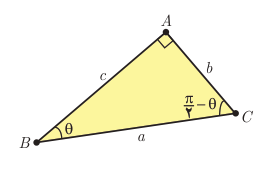

# درس ۲: نسبت‌های مثلثاتی برخی زوایا

در سال گذشته به مقدار نسبت‌های مثلثاتی برای برخی از زوایای تند (مانند $30^\circ$، $45^\circ$، $60^\circ$) و نیز زوایای مرزی ($0^\circ$، $90^\circ$، $180^\circ$، $270^\circ$، $360^\circ$) پرداختیم. همچنین علامت نسبت‌های مثلثاتی را در چهار ربع دایره مثلثاتی یاد گرفتیم. اکنون به مقدار این نسبت‌ها برای برخی دیگر از زوایا و رابطه بین آنها می‌پردازیم.

## نسبت‌های مثلثاتی زوایای متمم

می‌دانید که به هر دو زاویه‌ای که مجموع اندازه آنها $90^\circ$ باشد زاویه‌های متمم می‌گویند. نسبت‌های مثلثاتی چنین زاویه‌هایی با هم ارتباط دارند. فعالیت زیر به شما کمک می‌کند تا این روابط را پیدا کنید.

## فعالیت

یک مثلث قائم‌الزاویه دلخواه مانند شکل زیر را در نظر بگیرید.

با توجه به شکل، دو ستون روبه‌رو را همانند نمونه کامل و سپس مقادیر مساوی در دو ستون را با هم نظیر کنید.

| | |
|---|---|
| $\sin\theta=\frac ba$ | $\sin(\frac\pi2-\theta)=\frac ca$ |
| $\cos\theta=\ldots$ | $\cos(\frac\pi2-\theta)=\ldots$ |
| $\tan\theta=\ldots$ | $\tan(\frac\pi2-\theta)=\ldots$ |
| $\cot\theta=\ldots$ | $\cot(\frac\pi2-\theta)=\ldots$ |

در فعالیت قبل زاویه‌های مورد بحث تند بودند. روابط به‌دست آمده در آنجا در حالت کلی نیز برقرار است. به‌طور کلی برای دو زاویه متمم $\theta$ و $\frac\pi2-\theta$ همواره روابط روبه‌رو برقرار است.

$$\begin{aligned}
\sin(\tfrac\pi2-\theta)&=\cos\theta\\
\cos(\tfrac\pi2-\theta)&=\sin\theta\\
\tan(\tfrac\pi2-\theta)&=\cot\theta\\
\cot(\tfrac\pi2-\theta)&=\tan\theta
\end{aligned}$$
