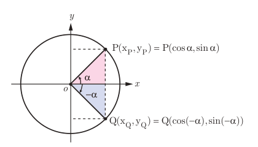

# فصل چهارم: مثلثات — ۹۹

## نسبت‌های مثلثاتی زوایای قرینه

### فعالیت

در دایره مثلثاتی روبه‌رو نقطه $P$ انتهای کمان روبه‌رو به زاویه $\alpha$ است. مختصات نقطه $P$ برحسب نسبت‌های مثلثاتی زاویه $\alpha$ که در سال گذشته آموختید، داده شده است. همچنین با توجه به دستگاه مختصات واضح است که قرینه نقطه $P(x_P,y_P)$ نسبت به محور $x$ها نقطه $Q(x_Q,y_Q)=Q(x_P,-y_P)$ می‌باشد.

الف) با توجه به رابطه بین مختصات نقاط $P$ و $Q$ روابط مثلثاتی زیر را مانند نمونه تکمیل کنید.

$$x_Q=x_P\Rightarrow\cos(-\alpha)=\cos\alpha$$
$$y_Q=-y_P\Rightarrow\quad\ldots$$

ب) طرف دوم تساوی‌های زیر را با استفاده از روابط به‌دست آمده از قسمت الف کامل کنید.

$$\tan(-\alpha)=\qquad\qquad\cot(-\alpha)=$$

دو زاویه $\alpha$ و $-\alpha$ قرینه یکدیگرند. برای دو زاویه قرینه روابط مثلثاتی زیر برقرار است.

$$\begin{aligned}
\sin(-\alpha)&=-\sin\alpha\\
\cos(-\alpha)&=\cos\alpha\\
\tan(-\alpha)&=-\tan\alpha\\
\cot(-\alpha)&=-\cot\alpha
\end{aligned}$$

## مقادیر نسبت‌های مثلثاتی زاویه‌های مکمل

دو زاویه را مکمل گوییم اگر مجموع آنها $180^\circ$ باشد. در فعالیت بعد روابط بین مقدار نسبت‌های مثلثاتی برای چنین زاویه‌هایی را به‌دست خواهیم آورد.
