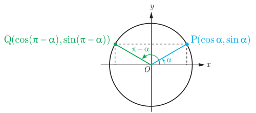

# ۱۰۰

## فعالیت

در دایره مثلثاتی روبه‌رو نقطه $P(x_P,y_P)$ انتهای کمان روبه‌رو به زاویه $\alpha$ است. با توجه به دستگاه مختصات واضح است که نقطه $Q(x_Q,y_Q)=Q(-x_P,y_P)$ قرینه نقطه $P$ نسبت به محور $y$ها است.

الف) با توجه به مختصات نقاط $P$ و $Q$ روابط زیر را همانند نمونه تکمیل کنید.

$$x_Q=-x_P\Rightarrow\cos(\pi-\alpha)=-\cos\alpha$$
$$y_Q=y_P\Rightarrow\ldots$$

ب) با توجه به روابط قسمت الف، تساوی‌های زیر را تکمیل کنید.

$$\tan(\pi-\alpha)=\qquad\qquad\cot(\pi-\alpha)=$$

از فعالیت قبل می‌توان نتیجه گرفت که بین هر دو زاویه مکمل $\alpha$ و $\pi-\alpha$ روابط زیر برقرار است.

$$\begin{aligned}
\sin(\pi-\alpha)&=\sin\alpha\\
\cos(\pi-\alpha)&=-\cos\alpha\\
\tan(\pi-\alpha)&=-\tan\alpha\\
\cot(\pi-\alpha)&=-\cot\alpha
\end{aligned}$$

زوایای $\alpha$ و $\pi+\alpha$ را در یک دایره مثلثاتی رسم کنید و نقاط انتهایی کمان‌های روبه‌رو به این دو زاویه را به ترتیب $P(x_P,y_P)$ و $Q(x_Q,y_Q)$ بنامید. از دستگاه مختصات واضح است که نقطه $Q$ قرینه نقطه $P$ نسبت به مبدأ مختصات است و از این رو $Q(x_Q,y_Q)=Q(-x_P,-y_P)$. اکنون با استدلالی مشابه به فعالیت بالا نشان دهید که روابط روبه‌رو برقرار است.

$$\begin{aligned}
\sin(\pi+\alpha)&=-\sin\alpha\\
\cos(\pi+\alpha)&=-\cos\alpha\\
\tan(\pi+\alpha)&=\tan\alpha\\
\cot(\pi+\alpha)&=\cot\alpha
\end{aligned}$$

### مثال

مقدار نسبت‌های مثلثاتی برخی زوایا در زیر محاسبه شده است.

$$\sin(-\tfrac{7\pi}{6})=-\sin(\tfrac{7\pi}{6})=-\sin(\pi+\tfrac\pi6)=\sin\tfrac\pi6=\tfrac12$$
$$\tan(225^\circ)=\tan(180^\circ+45^\circ)=\tan45^\circ=1$$
$$\cos(120^\circ)=\cos(180^\circ-60^\circ)=-\cos(60^\circ)=-\tfrac12$$
