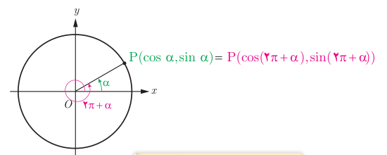
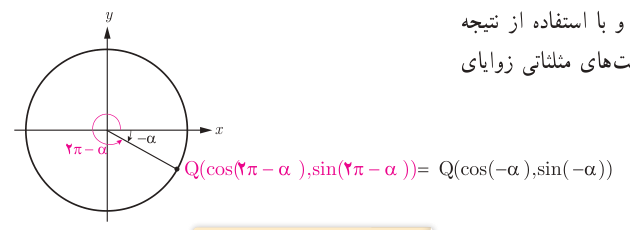

# فصل چهارم: مثلثات — ۱۰۱

## نسبت‌های مثلثاتی زوایای با مجموع یا تفاضل $2k\pi$ رادیان

زاویه‌هایی مانند $\alpha$ و $2\pi+\alpha$ در شکل زیر که انتهای کمان‌های آنها برهم منطبق می‌شود را زوایای هم انتها گویند. از آنجا که نقطه $P$ انتهای هر دو کمان می‌باشد لذا نسبت‌های مثلثاتی این دو زاویه با هم برابرند.

$$\begin{aligned}
\sin(2\pi+\alpha)&=\sin\alpha\\
\cos(2\pi+\alpha)&=\cos\alpha\\
\tan(2\pi+\alpha)&=\tan\alpha\\
\cot(2\pi+\alpha)&=\cot\alpha
\end{aligned}$$

این حالت برای بیش از یک دوران کامل، یعنی زوایای به‌صورت $2k\pi+\alpha$، نیز برقرار است. $(k\in\mathbb Z)$

$$\begin{aligned}
\sin(2k\pi+\alpha)&=\sin\alpha\\
\cos(2k\pi+\alpha)&=\cos\alpha\\
\tan(2k\pi+\alpha)&=\tan\alpha\\
\cot(2k\pi+\alpha)&=\cot\alpha
\end{aligned}$$

از آنجا که زوایای $-\alpha$ و $2k\pi-\alpha$ $(k\in\mathbb Z)$ نیز هم انتها هستند (چرا؟)، با استدلالی مشابه بالا و با استفاده از نتیجه فعالیت صفحه قبل نشان دهید که نسبت‌های مثلثاتی زوایای $2k\pi-\alpha$ به‌صورت زیر برقرارند.

$$\begin{aligned}
\sin(2k\pi-\alpha)&=-\sin\alpha\\
\cos(2k\pi-\alpha)&=\cos\alpha\\
\tan(2k\pi-\alpha)&=-\tan\alpha\\
\cot(2k\pi-\alpha)&=-\cot\alpha
\end{aligned}$$

### مثال

مقدار نسبت‌های مثلثاتی برخی زوایا در زیر محاسبه شده است.

الف) $\tan(\frac{5\pi}{3})=\tan(2\pi-\frac\pi3)=-\tan(\frac\pi3)=-\sqrt3$

ب) $\sin(405^\circ)=\sin(360^\circ+45^\circ)=\sin(45^\circ)=\frac{\sqrt2}{2}$
