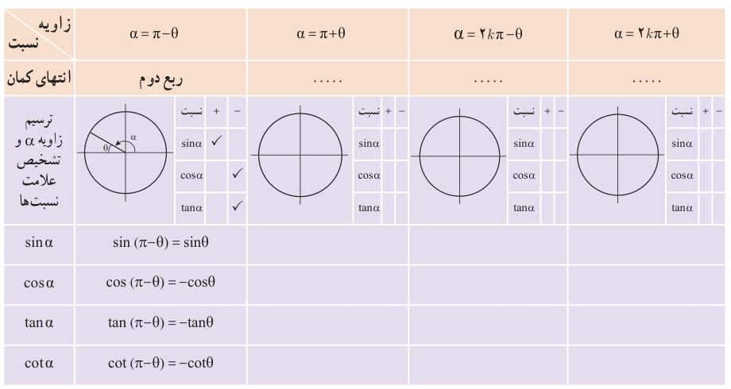

# ۱۰۲

## کار در کلاس

۱. مقدار نسبت‌های مثلثاتی زیر را به‌دست آورید.

الف) $\sin(210^\circ)=$

ب) $\tan(-\frac{7\pi}{4})=$

پ) $\cot(135^\circ)=$

ت) $\sin(\frac{3\pi}{4})=$

۲. جدول زیر را همانند نمونه کامل کنید. $(0<\theta<\frac\pi2)$

| زاویه / نسبت | $\alpha=\pi-\theta$ | $\alpha=\pi+\theta$ | $\alpha=2k\pi-\theta$ | $\alpha=2k\pi+\theta$ |
|---|---|---|---|---|
| انتهای کمان | ربع دوم | … | … | … |
| ترسیم زاویه $\alpha$ و تشخیص علامت نسبت‌ها | مطابق شکل |  |  |  |
| $\sin\alpha$ | $\sin(\pi-\theta)=\sin\theta$ | | | |
| $\cos\alpha$ | $\cos(\pi-\theta)=-\cos\theta$ | | | |
| $\tan\alpha$ | $\tan(\pi-\theta)=-\tan\theta$ | | | |
| $\cot\alpha$ | $\cot(\pi-\theta)=-\cot\theta$ | | | |

۳. برای زوایای قرینه $(\alpha=-\theta)$ از کدام ستون جدول بالا می‌توان کمک گرفت؟ چرا؟
