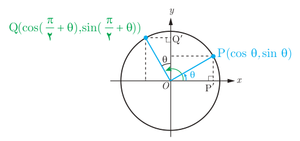

# فصل چهارم: مثلثات — ۱۰۳

## فعالیت

در دایره مثلثاتی زیر زاویه‌های $\theta$ و $\frac\pi2+\theta$ رسم شده‌اند.

الف) با توجه به شکل، نشان دهید دو مثلث $OPP'$ و $OQQ'$ هم‌نهشت هستند.

ب) از تساوی اضلاع نظیر در دو مثلث فوق روابط زیر را همانند نمونه تکمیل کنید.

$$x_Q=-y_P\Rightarrow\cos(\tfrac\pi2+\theta)=-\sin\theta$$
$$y_Q=\ldots$$

پ) طرف دوم تساوی‌های زیر را با استفاده از روابط قسمت ب کامل کنید.

$$\tan(\tfrac\pi2+\theta)=\ldots\qquad\cot(\tfrac\pi2+\theta)=\ldots$$

به‌طور کلی برای دو زاویه $\theta$ و $\frac\pi2+\theta$ روابط زیر برقرار است.

$$\begin{aligned}
\sin(\tfrac\pi2+\theta)&=\cos\theta\\
\cos(\tfrac\pi2+\theta)&=-\sin\theta\\
\tan(\tfrac\pi2+\theta)&=-\cot\theta\\
\cot(\tfrac\pi2+\theta)&=-\tan\theta
\end{aligned}$$
