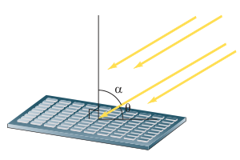

# ۱۰۴

## تمرین

۱. مقدار نسبت‌های مثلثاتی زیر را به‌دست آورید.

الف) $\sin(300^\circ)=$　 ب) $\cot(750^\circ)=$　 پ) $\cos(-\frac\pi6)=$

ت) $\cos(-\frac{23\pi}{4})=$　 ث) $\sin(\frac{5\pi}{4})=$　 ج) $\tan(-840^\circ)=$

چ) $\tan(-150^\circ)=$　 ح) $\cos(\frac{9\pi}{4})=$　 خ) $\tan(\frac{10\pi}{3})=$

۲. شدت نور وارد بر یک سلول خورشیدی، با زاویه تابش $\alpha$ در ارتباط است (شکل زیر). اگر شدت نور را با $I$ نشان دهیم، رابطه $I=k\sin(\frac\pi2-\alpha)$ که در آن $k$ یک عدد ثابت مثبت است، شدت نور را به‌دست می‌دهد.

الف) با توجه به شکل و با استفاده از روابط مثلثاتی، رابطه شدت نور را بر حسب کسینوس زاویه $\theta$ در شکل بازنویسی کنید.

ب) شدت نور را برای زاویه‌های $\theta=0$، $\theta=\frac\pi6$ و $\theta=\frac\pi3$ بر حسب $k$ به‌دست آورید.

پ) زاویه $\theta$ چقدر باشد تا بیشترین شدت نور به‌دست آید؟ چرا؟ (راهنمایی: از دایره مثلثاتی کمک بگیرید.)

۳. درستی یا نادرستی عبارات زیر را مشخص کنید (زوایا برحسب رادیان است).

الف) $\cos\theta+\cos(\pi-\theta)=0$

ب) $\sin(\frac\pi2-\theta)+\cos\theta=1$

ج) $\cos(7)=\cos(-7)$

د) $\tan(\pi-\theta)=\tan\pi-\tan\theta$
