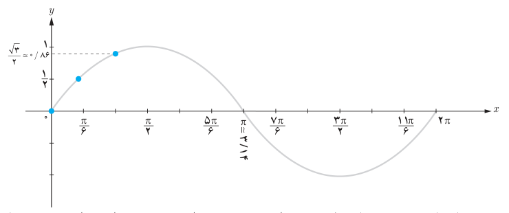

# درس ۳: توابع مثلثاتی

در درس‌های قبل مقدار نسبت‌های مثلثاتی را برای برخی زوایا به‌دست آوردیم. اکنون این سؤال به ذهن می‌رسد که آیا می‌توان این نسبت‌ها را برای یک عدد حقیقی تعریف کرد؟ مثلاً عبارات $\sin3$ یا $\cos3$ چه مفهومی دارند؟ فعالیت زیر به شما کمک می‌کند تا پاسخ این سؤالات را بیابید.

## فعالیت

۱. در جدول زیر نسبت سینوس به ازای برخی مقادیر در بازه $[0,2\pi]$ مشخص شده است. این جدول را تکمیل کنید.

| $x$ (رادیان) | ۰ | $\frac\pi6$ | $\frac\pi3$ | $\frac\pi2$ | $\frac{5\pi}6$ |  | $\frac{7\pi}6$ | $\frac{3\pi}2$ | $\frac{11\pi}6$ | $2\pi$ |
|---|---|---|---|---|---|---|---|---|---|---|
| $y=\sin x$ | ۰ | $\frac12$ | $\frac{\sqrt3}2\simeq0/86$ | | | ۰ | | −۱ | | |

۲. جدول بالا به‌صورت زوج مرتب در زیر داده شده است. با توجه به جدول فوق مجموعه زوج مرتب‌ها را تکمیل و سپس نقاط به‌دست آمده را در دستگاه مختصات زیر پیدا کنید. آیا نقاط متناظر با زوج‌های مرتب روی منحنی داده شده قرار می‌گیرند؟ آیا این منحنی تابع است؟ (با رسم خطوط موازی محور $y$ها بررسی کنید).

$$f=\{(0,0),(\tfrac\pi6,\tfrac12),(\tfrac\pi3,\tfrac{\sqrt3}2),(\tfrac\pi2,\ldots),(\tfrac{5\pi}6,\ldots),(\ldots,0),(\tfrac{7\pi}6,\ldots),(\tfrac{3\pi}2,-1),(\tfrac{11\pi}6,\ldots),(2\pi,\ldots)\}$$

۳. نمودار داده شده در سؤال قبل منحنی تابع $y=\sin x$ در بازه $[0,2\pi]$ می‌باشد. با توجه به نمودار، مقدار $\sin1$ کجای محور $y$ها قرار می‌گیرد؟
