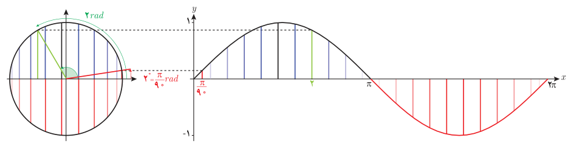
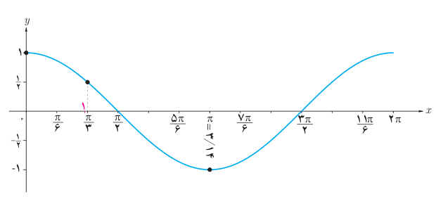
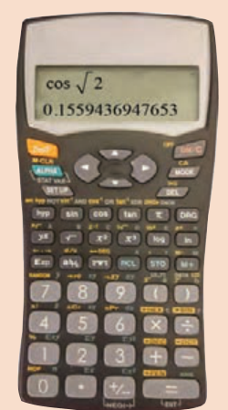

# ۱۰۶

۴. در تابع $y=\sin x$، همیشه $x$ را برحسب رادیان در نظر می‌گیرند مگر آنکه صریحاً گفته شود $x$ بر حسب درجه است یا از نماد $x^\circ$ استفاده شود. با توجه به ارتباط دایره مثلثاتی و نمودار تابع سینوس که در زیر داده شده، تفاوت $\sin2$ و $\sin2^\circ$ را بیان کنید.

## فعالیت

۱. همانند فعالیت قبل، تابع $y=\cos x$ در زیر رسم شده است. مجموعه زوج‌های مرتب داده شده از این تابع را تکمیل کنید و نقاط به‌دست آمده را مانند نمونه بر روی نمودار نمایش دهید.

$$f=\{(0,1),(\tfrac\pi3,\tfrac12),(\tfrac\pi2,\ldots),(\tfrac{2\pi}3,\ldots),(\pi,-1),(\tfrac{4\pi}3,\ldots),(\tfrac{3\pi}2,\ldots),(\tfrac{5\pi}3,\ldots),(2\pi,\ldots)\}$$

۲. در نمودار بالا ابتدا نقطه نظیر $\sqrt2$ رادیان را بر روی محور $x$ها بیابید و سپس مکان $\cos\sqrt2$ را بر روی محور $y$ها به‌طور تقریبی پیدا کنید. درستی پاسخ خود را با ماشین حساب بررسی کنید.

## خواندنی

در ماشین‌حساب‌های پیشرفته، برای محاسبه نسبت‌های مثلثاتی می‌توان از دو حالت استفاده کرد که یک حالت بر حسب درجه (DEG) و حالت دیگری برحسب رادیان (RAD) است. هنگام استفاده از ماشین حساب باید ابتدا آن را در حالت مورد نظر قرار داد. در ماشین‌حساب زیر آن را در حالت رادیان قرار داده و سپس مقدار $\cos\sqrt2$ را حساب کرده‌اند.

