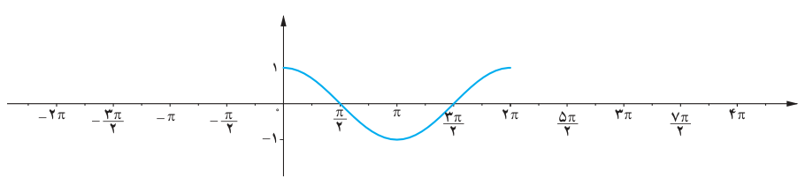
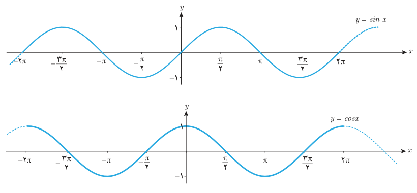

# فصل چهارم: مثلثات — ۱۰۷

۳. از درس‌های قبل می‌دانیم که $\cos(x+2k\pi)=\cos x$ و نیز $\cos(-x)=\cos x$. با استفاده از این روابط مقدار تابع $y=\cos x$ را در دیگر نقاط داده شده بر روی محور $x$ها به‌دست آورید و نمودار تابع را از دو طرف ادامه دهید. آیا نمودار این تابع در بازه‌های $[2\pi,4\pi]$ و $[0,2\pi]$ و $[-2\pi,0]$ با هم متفاوت هستند؟

۴. با توجه به نمودار تابع $y=\cos x$ در بازه $[-2\pi,4\pi]$ به سؤالات زیر پاسخ دهید.

الف) آیا می‌توان بر روی محور $x$ها عددی مانند $x_0$ یافت که برای آن $\cos x_0=\frac13$ باشد؟

ب) آیا می‌توان بر روی محور $x$ها عددی مانند $x_0$ یافت که برای آن $\cos x_0=2$ باشد؟

پ) بیشترین و کمترین مقدار تابع $y=\cos x$ در این بازه چقدر است؟

تابع‌های $y=\sin x$ و $y=\cos x$ را مثلثاتی گویند. دامنه این توابع مجموعه اعداد حقیقی و برد آنها بازه $[-1,1]$ است. گاهی به نمودار تابع $y=\sin x$ موج سینوسی و به نمودار تابع $y=\cos x$ موج کسینوسی نیز می‌گویند.

همان‌طور که در فعالیت ۲ بررسی شد تابع $y=\cos x$ در بازه‌های به طول $2\pi$ تکرار می‌شود. این وضعیت برای تابع $y=\sin x$ نیز برقرار است (چرا؟). با توجه به این ویژگی در توابع مثلثاتی بالا، می‌توان نمودار آنها را به‌صورت زیر رسم کرد.

