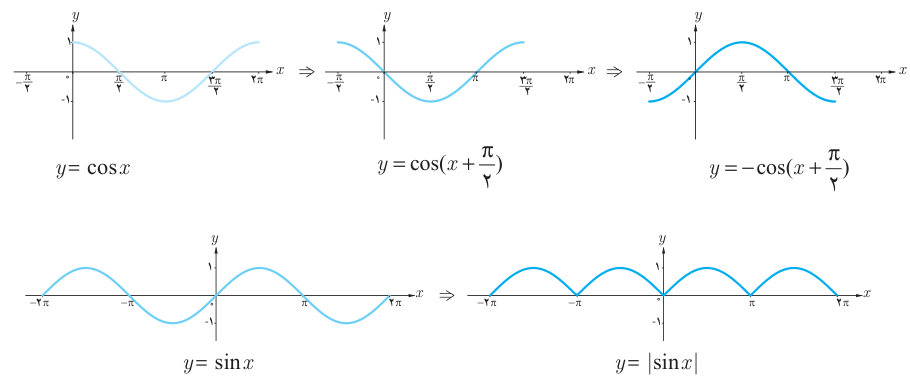
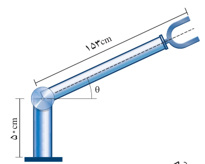
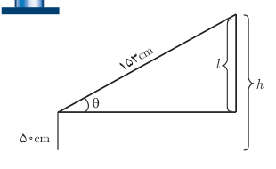

# ۱۰۸

## کار در کلاس

درستی یا نادرستی عبارات زیر را مشخص کنید.

الف) $\sin x$ یعنی سینوس زاویه‌ای از دایره مثلثاتی که اندازه آن $x$ درجه باشد.

ب) $\sin\sqrt5$ یک عدد حقیقی است.

پ) $\cos3=\cos3^\circ$.

ت) اگر $0<x<\frac\pi2$ آنگاه $-1<\cos x<0$ است.

ث) عددی می‌توان یافت که سینوس آن برابر ۲− باشد.

ج) $x=\pi$ صفر تابع $f(x)=\cos x$ است.

### مثال

با توجه به نمودار توابع مثلثاتی $y=\sin x$ و $y=\cos x$، نمودار توابع $y=-\cos(x+\frac\pi2)$ و $y=|\sin x|$ در زیر رسم شده است.

### مثال

روبات‌ها در زمینه‌های مختلف کاربرد دارند. در طراحی انواع روبات‌ها از توابع مثلثاتی استفاده می‌شود. در شکل روبه‌رو یک روبات صنعتی را که در صنایع خودروسازی کاربرد دارد مشاهده می‌کنید. با توجه به مقادیر داده شده، ارتفاع نوک گیره روبات را از سطح زمین به کمک یک تابع مثلثاتی مدل‌سازی کنید. $(0\leq\theta\leq\frac\pi2)$

### حل

کافی است وضعیت روبات را به‌صورت زیر ترسیم کنیم. اکنون کل ارتفاع نوک گیره از سطح زمین $(h)$ به‌صورت زیر به‌دست می‌آید:

$$\sin\theta=\frac l{153}\Rightarrow l=153\sin\theta$$
$$\Rightarrow h=50+l=50+153\sin\theta$$
