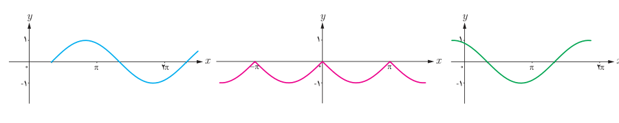
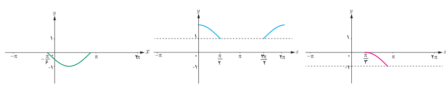
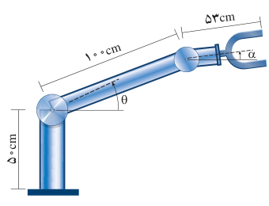

# فصل چهارم: مثلثات — ۱۰۹

## تمرین

۱. توابع مثلثاتی زیر را با نمودارهای داده شده نظیر کنید.

الف) $y=-|\sin x|$　 ب) $y=\cos(x+\frac\pi6)$　 پ) $y=\sin(x-\frac\pi3)$

۲. در هر یک از نمودارهای زیر بخشی از یک تابع مثلثاتی رسم شده است. با توجه به بخش رسم شده، توابع مثلثاتی داده شده در زیر را به نمودارها نظیر کنید و سپس نمودار را کامل سازید.

الف) $y=-\sin(x+\frac\pi6)$　 ب) $y=\cos(x-\frac\pi3)-1$　 پ) $y=1+|\cos x|$

۳. با توجه به نمودارهای بالا در سؤال ۲، بیشترین و کمترین مقدار توابع مثلثاتی داده شده در آن سؤال در چه نقاطی رخ می‌دهد؟

۴. با توجه به نمودارهای سؤال ۲، کدام‌یک از توابع مثلثاتی داده شده در آن سؤال در بازه $(0,\pi)$ یک به یک است؟

۵. در طراحی روبات‌های صنعتی برای انعطاف بیشتر در حرکت روبات‌ها، معمولاً دو مفصل مکانیکی برای بازوی آن به‌صورت روبه‌رو در نظر می‌گیرند.

الف) ارتفاع نوک گیره این روبات را، از سطح زمین، بر اساس توابعی از $\theta$ و $\alpha$ مدل‌سازی کنید. $(-\frac\pi2\leq\alpha\leq\frac\pi2,\ 0\leq\theta\leq\frac\pi2)$

ب) فرض کنید این روبات برای گرفتن یک شیء در ارتفاع $23/5\,cm$ مفصل دوم خود را در حالت $\alpha=-30^\circ$ قرار داده است. تعیین کنید زاویه $\theta$ در این وضعیت چند درجه است؟
