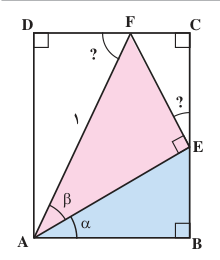

# درس ۴: روابط مثلثاتی مجموع و تفاضل زوایا

در سال گذشته با تعدادی از اتحادهای مثلثاتی مانند $\sin^2\alpha+\cos^2\alpha=1$ و $1+\tan^2\alpha=\frac1{\cos^2\alpha}$ $(\cos\alpha\ne0)$ آشنا شدید. این اتحادها تنها شامل یک زاویه هستند. اکنون در این درس، روابطی را که در آنها دو زاویه مختلف به‌کار رفته است فرا می‌گیرید.

## فعالیت

۱. در شکل روبه‌رو، چهارضلعی $ABCD$ یک مستطیل است. اندازه پاره‌خط $AF$ برابر ۱ و زوایای $\alpha$ و $\beta$ داده شده است.

الف) با تکمیل روابط زیر اندازه $\angle FEC$ و $\angle AFD$ را بر حسب $\alpha$ و $\beta$ به‌دست آورید.

$$\begin{cases}
\angle FEC+90^\circ+\angle AEB=180^\circ&:\text{زاویه E نیم‌صفحه است}\\
\alpha+90^\circ+\angle AEB=180^\circ&:\text{مجموع زوایای داخلی ABE}
\end{cases}\Rightarrow\angle FEC=\ldots$$

$$\text{اضلاع }AB\text{ و }DC\text{ با هم موازی و پاره‌خط }AF\text{ به‌صورت مورب آن را قطع کرده است}\Rightarrow\angle AFD=\ldots$$

ب) اندازه اضلاع $AD$ و $DF$ از مثلث $ADF$ را با توجه به اینکه $AF=1$، برحسب نسبت‌های سینوس و کسینوس $\angle DFA$ بنویسید.

پ) اضلاع $AE$ و $EF$ از مثلث قائم‌الزاویه $AEF$ را، که وتر آن برابر ۱ است، برحسب نسبت‌های سینوس و کسینوس زاویه $\beta$ بنویسید.

ت) اندازه پاره‌خط‌های $BE$، $EC$، $FC$ و $AB$ را برحسب نسبت‌های سینوس و کسینوس زاویه $\alpha$ به‌دست آورید.
