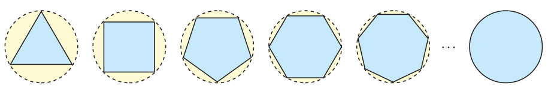

# درس ۱: مفهوم حد و فرایندهای حدی

بیشتر پدیده‌های طبیعی و مسائل محیط پیرامون را می‌توان مدل‌سازی نمود و مدل ریاضی بسیاری از این پدیده‌ها، به‌صورت یک تابع درمی‌آید.

گاهی اوقات لازم است، برای تحلیل یک پدیده، رفتار تابع متناظر آن را در نزدیکی یک نقطه مورد ارزیابی قرار دهیم. مفهوم «حد» ابزار مناسبی است که می‌تواند در تحلیل رفتار تابع به ما کمک شایانی نماید.

## فعالیت

در شکل زیر، شعاع دایره‌ها، برابر ۱ واحد است.

۱. با افزایش اضلاع چندضلعی‌های محاط در دایره، مساحت چندضلعی به مساحت چه شکلی نزدیک می‌شود؟

۲. مساحت دایره‌ای به شعاع ۱ چقدر است؟

۳. اگر مقدار تقریبی عدد $\pi$ تا ۵ رقم اعشار را برابر $\pi=3/14159$ در نظر بگیریم و مساحت $n$ضلعی منتظم واقع در درون دایره را با $A_n$ نشان دهیم، جدول زیر مقادیر $A_n$ را به ازای برخی $n\in\mathbb N$ نشان می‌دهد:

| $n$ | ۳ | ۴ | ۵ | ۶ | ۷ | ۸ | ۹ | ۱۰ | ۲۰۰ | ۳۰۰ | ۴۰۰ | ۵۰۰ | ۱۰۰۰ |
|---|---|---|---|---|---|---|---|---|---|---|---|---|---|
| $A_n$ | ۱/۲۹۹۰۳ | ۲ | ۲/۳۷۷۶۴ | ۲/۵۹۸۰۷ | ۲/۷۳۶۴۱ | ۲/۸۲۸۴۲ | ۲/۸۹۲۵۴ | ۲/۹۳۸۹۲ | ۳/۱۴۱۰۷ | ۳/۱۴۱۳۶ | ۳/۱۴۱۴۶ | ۳/۱۴۱۵۰ | ۳/۱۴۱۵۷ |

۴. با توجه به این جدول، هرچه تعداد اضلاع چندضلعی‌های داخل دایره زیاد می‌شود، جملات دنباله $A_n$ (مساحت $n$ضلعی درون دایره) به عدد … که برابر مساحت دایره است نزدیک می‌شوند.

مساحت چندضلعی‌های منتظم درون دایره (محاطی) را به هر اندازه که بخواهیم، می‌توانیم به مساحت دایره نزدیک کنیم، به شرط آنکه تعداد اضلاع را به اندازه کافی زیاد کنیم.
