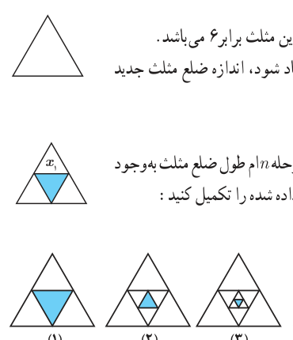

# فصل پنجم: حد و پیوستگی — ۱۱۵

## خواندنی

عدد $\pi$ (پی) سرگذشتی حداقل ۳۷۰۰ ساله دارد. پی یکی از مشهورترین عددها در دنیای ریاضی است و با نماد $\pi$، یکی از حروف الفبای یونانی نشان داده می‌شود. ساده‌ترین و بهترین راه معرفی $\pi$ این است:

$$\pi=\frac{\text{محیط دایره}}{\text{قطر دایره}}$$

$\pi$ یک عدد گنگ است و در طول این ۳۷ قرن، دانشمندان زیادی سعی کرده‌اند مقدار دقیق آن را حساب کنند. قدیمی‌ترین محاسبه به‌دست آمده، به ۱۷۰۰ سال قبل از میلاد مربوط می‌شود. این محاسبات روی پاپیروسی نوشته شده است که در حال حاضر، در موزه‌ای در «مسکو» نگهداری می‌شود. حدود ۲۴۰ سال قبل از میلاد، ارشمیدس اولین روش کلاسیک را برای تعیین مقدار تقریبی عدد $\pi$ ارائه داد.

ارشمیدس با استفاده از چندضلعی‌های محاطی و محیطی درون و بیرون یک دایره به شعاع واحد به محاسبه تقریبی عدد $\pi$ پرداخت. او با ۶ضلعی منتظم شروع و مرتباً تعداد اضلاع را دو برابر کرد و با استفاده از ۹۶ضلعی منتظم محیطی و محاطی، مقدار $\pi$ را با تقریب بسیار خوبی $(3/1408<\pi<3/14285)$ به‌دست آورد.

غیاث‌الدین جمشید کاشانی معروف به «الکاشی» در کتاب رساله محیطیه $\pi$ را تا ۱۷ رقم پس از ممیز حساب کرده است.

اگر می‌خواهید عدد $\pi$ را تا ده رقم اعشار به خاطر بسپارید تعداد حروف کلمات، در بیت دوم این شعر به شما کمک خواهد کرد:

گر کسی از تو بپرسد ره دانستن پی　 پاسخی ده که هنرمند تو را آموزد  
خرد و دانش و آگاهی دانشمندان　 ره سرمنزل مقصود بما آموزد

$$\pi=3/1415926535\ldots$$

## فعالیت

یک مثلث متساوی‌الاضلاع به طول ضلع ۲ را در نظر بگیرید، اندازه محیط این مثلث برابر ۶ می‌باشد.

۱. مطابق شکل، وسط اضلاع را به هم وصل می‌کنیم تا مثلث جدیدی ایجاد شود، اندازه ضلع مثلث جدید را $x_1$ و اندازه محیط آن را $P_1$ می‌نامیم. در این صورت داریم: $x_1=\ldots$ و $P_1=\ldots$.

۲. اگر عمل وصل کردن وسط ضلع‌های مثلث‌های جدید را ادامه دهیم و در مرحله $n$ام طول ضلع مثلث به‌وجود آمده را با $x_n$ و محیط آن را با $P_n$ نمایش دهیم، با توجه به شکل‌های زیر، جدول داده شده را تکمیل کنید:

| $x_n$ | ۱ | $\frac12$ | $\frac14$ | $\frac18$ | | | … | $\frac1{2^n}$ |
|---|---|---|---|---|---|---|---|---|
| $P_n$ | ۳ | $\frac32$ | $\frac34$ | | | | … | |

۳. اندازه اضلاع مثلث‌ها، به چه عددی نزدیک می‌شوند؟

۴. اندازه محیط این مثلث‌ها، به چه عددی نزدیک می‌شوند؟

در فعالیت قبل، اگر طول ضلع اولیه را $x$ در نظر بگیریم و $f$ تابعی باشد که محیط مثلث را برحسب ضلع آن بیان می‌کند، آن‌گاه داریم $f(x)=3x$.

همان‌طور که مشاهده کردیم، وقتی طول ضلع مثلث‌ها (مقدار متغیر $x$) به عدد صفر نزدیک می‌شود، محیط مثلث‌ها، یعنی مقادیر تابع $f$، نیز به عدد صفر نزدیک می‌شود.
