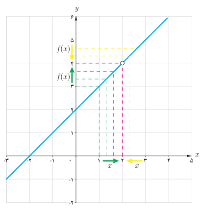

# ۱۱۶

### مثال

رفتار تابع $f$، با ضابطه $f(x)=\frac{x^2-4}{x-2}$ را در اطراف نقطه $a=2$ بررسی نمایید.

### حل

تابع $f$، به ازای هر عدد حقیقی $x$ به جز $x=2$ تعریف شده است. به ازای هر $x\ne2$، ضابطه تابع را می‌توان ساده کرد و به‌صورت زیر نوشت:

$$f(x)=\frac{(x-2)(x+2)}{x-2}=x+2$$

در جدول زیر، مقادیر تابع $f$ را به ازای برخی مقادیر کوچک‌تر از ۲، که به‌تدریج از سمت چپ به عدد ۲ نزدیک می‌شوند، و نیز برخی مقادیر بزرگ‌تر از ۲، که به‌تدریج از سمت راست به ۲ نزدیک می‌شوند، محاسبه کرده‌ایم:

| $x$ | ۱ | ۱/۵ | ۱/۹ | ۱/۹۹ | ۱/۹۹۹ | → | ۲ | ← | ۲/۰۰۰۱ | ۲/۰۰۱ | ۲/۰۱ | ۲/۵ | ۳ |
|---|---|---|---|---|---|---|---|---|---|---|---|---|---|
| $f(x)$ | ۳ | ۳/۵ | ۳/۹ | ۳/۹۹ | ۳/۹۹۹ | → | ؟ | ← | ۴/۰۰۰۱ | ۴/۰۰۱ | ۴/۰۱ | ۴/۵ | ۵ |

با توجه به جدول فوق، مشاهده می‌کنیم که، با نزدیک شدن $x$ به عدد ۲ (از راست و از چپ)، مقادیر $f(x)$، به عدد ۴ نزدیک می‌شوند.

درستی این مطلب را از روی نمودار تابع نیز می‌توان دید: نمودار تابع $f$، خط راست $y=x+2$ است که یک نقطه از آن، یعنی نقطه $(2,4)$ حذف شده است.

با وجود اینکه مقدار تابع در نقطه ۲ تعریف نشده است ولی با توجه به نمودار تابع، وقتی $x$ را با مقادیر بزرگ‌تر و یا کوچک‌تر از ۲ (اما مخالف ۲) به عدد ۲ نزدیک می‌کنیم، مقادیر تابع $f$ به عدد ۴ نزدیک می‌شوند. به عبارت دیگر وقتی $x\to2$ (یعنی $x$ به سمت ۲ میل می‌کند)، مقادیر تابع $f$ به عدد ۴ نزدیک می‌شوند. در این صورت می‌گوییم، حد تابع $f$ وقتی $x$ به ۲ نزدیک می‌شود برابر ۴ است و می‌نویسیم:

$$\lim_{x\to2}f(x)=4$$

در مثال بالا، رفتار تابعی مانند $f$ را در اطراف نقطه‌ای مانند $a$ بررسی و مشاهده کردیم که وقتی متغیر $x$ به $a$ نزدیک می‌شود مقادیر تابع $f$ نیز به یک عدد مشخص، نزدیک می‌شوند. این مفهوم را «حدگیری» از تابع $f$ در نقطه $a$ می‌نامیم.
