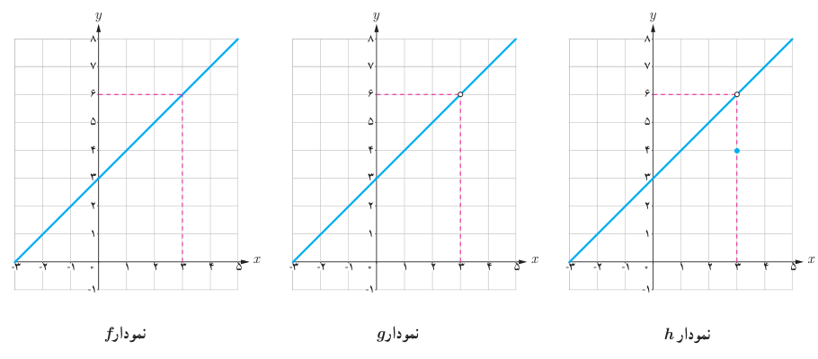

# فصل پنجم: حد و پیوستگی — ۱۱۷

## کار در کلاس

توابع $f$، $g$ و $h$ با ضابطه‌های $f(x)=x+3$، $g(x)=\frac{x^2-9}{x-3}$ و $h(x)=\begin{cases}x+3&x\ne3\\4&x=3\end{cases}$ را در نظر بگیرید:

۱. مقادیر زیر را در صورتی که تعریف شده باشند به‌دست آورید:

$$f(3)=\ldots\qquad g(3)=\ldots\qquad h(3)=\ldots$$

۲. با تکمیل جدول زیر، حدس بزنید که وقتی مقادیر $x$ را به عدد ۳ نزدیک می‌کنیم، مقادیر توابع $f$، $g$ و $h$ هرکدام به چه عددی نزدیک می‌شوند.

| $x$ | ۲/۹ | ۲/۹۹ | ۲/۹۹۹ | ۲/۹۹۹۹ | → | ۳ | ← | ۳/۰۰۰۰۱ | ۳/۰۰۰۱ | ۳/۰۰۱ | ۳/۰۱ | ۳/۱ |
|---|---|---|---|---|---|---|---|---|---|---|---|---|---|
| $f(x)$ | ۵/۹ | ۵/۹۹ | ۵/۹۹۹ | ۵/۹۹۹۹ | → | ؟ | ← | ۶/۰۰۰۰۱ | ۶/۰۰۰۱ | ۶/۰۰۱ | ۶/۰۱ | ۶/۱ |
| $g(x)$ | … | … | … | … | → | ؟ | ← | … | … | … | … | … |
| $h(x)$ | … | … | … | … | → | ؟ | ← | … | … | … | … | … |

۳. نمودارهای توابع $f$، $g$ و $h$ به‌صورت زیر رسم شده است. از روی نمودار، توضیح دهید که وقتی مقادیر $x$ را به ۳ نزدیک می‌کنیم، مقادیر $f(x)$، $g(x)$ و $h(x)$ هرکدام به چه عددی نزدیک می‌شوند.

