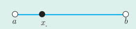
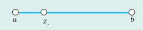

# ۱۱۸

۴. حد هر سه تابع وقتی $x$ به عدد ۳ نزدیک می‌شود برابر … است به عبارت دیگر:

$$\lim_{x\to3}f(x)=\ldots\qquad\lim_{x\to3}g(x)=\ldots\qquad\lim_{x\to3}h(x)=\ldots$$

۵. با توجه به جدول صفحه قبل و نمودار و ضابطه سه تابع، تفاوت‌ها و شباهت‌های این سه تابع را بیان کنید.

از کار در کلاس قبل نتیجه می‌گیریم که:

الف) ممکن است یک تابع در نقطه $a$ تعریف نشده باشد، اما حد این تابع وقتی $x$ به $a$ نزدیک می‌شود موجود باشد. (مانند تابع $g$ در نقطه ۳)

ب) ممکن است یک تابع در نقطه $a$ تعریف شده باشد و در این نقطه دارای حد نیز باشد، ولی مقدار این حد با مقدار تابع در $a$ برابر نباشد. (مانند تابع $h$ در نقطه ۳).

در حقیقت با اینکه سه تابع داده شده از نظر مقدار در نقطه ۳ با هم متفاوت‌اند و حتی تابع $g$ در نقطه ۳ تعریف نشده است ولی در اطراف نقطه ۳ رفتار کاملاً یکسانی دارند، یعنی حد هر سه تابع وقتی $x$ به ۳ نزدیک می‌شود برابر با ۶ است.

با توجه به مفهوم حد، به نظر می‌رسد برای آنکه بتوان مقادیر متغیر را از دو طرف (چپ و راست) به عددی مانند $a$، نزدیک نمود، کافی است تابع موردنظر در یک بازه باز شامل $a$ تعریف شده باشد. البته در محاسبه حد تابع در نقطه $a$، رفتار تابع در دو طرف نقطه $a$ اهمیت دارد، پس لزومی ندارد خود $a$ در دامنه تابع باشد. بنابراین لازم است به تعریف همسایگی یک نقطه که یکی از مفاهیم اساسی برای تعریف حد تابع در یک نقطه می‌باشد بپردازیم:

## تعریف

اگر $x_0$ یک عدد حقیقی باشد، هر بازه باز شامل $x_0$ را یک همسایگی $x_0$ می‌نامیم.

بنابراین اگر $x_0\in(a,b)$، آن‌گاه بازه $(a,b)$ یک همسایگی $x_0$ است.

اگر نقطه $x_0$ را از این بازه حذف کنیم، مجموعه $(a,b)-\{x_0\}$ را همسایگی محذوف $x_0$ می‌نامیم.

به همین ترتیب: اگر $r>0$، در این صورت بازه $(x_0,x_0+r)$ را یک همسایگی راست و بازه $(x_0-r,x_0)$ را یک همسایگی چپ $x_0$ می‌نامیم.
